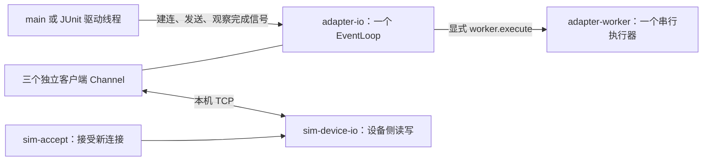

# Netty 与 Java 并发：组件、概念与用法

补充时间：2026-11-16。本页针对当前学习模块，配合源码注释和[断点指南](debugging-guide.md)阅读。先知道组件解决什么问题，再进入实验观察它实际在哪条线程执行。

## 1. 按技术大类选择学习主题

JUnit 类 `ConcurrencyScenariosTest` 是总入口，`@DisplayName` 将“大类｜主题｜验证点”显示在 IDEA 的测试树里。方法名保持英文，方便搜索与单项执行。

| 技术大类 | 分类主题 | 要回答的问题 | Demo／测试方法 |
| --- | --- | --- | --- |
| Netty | 线程模型 | 三条连接为什么能共用一条 I/O？ | `SharedEventLoopDemo`／`channelsShareIoWithoutSharingIdentity` |
| Netty | 回调执行 | 移到 worker 后，谁不再被阻塞，谁仍需排队？ | `CallbackOffloadDemo`／`slowCallbackSeparatesIoAndWorkerProgress` |
| Netty | 定时调度 | 等待期间怎样继续收发，怎样取消旧步骤？ | `ScheduledSequenceDemo`／`delayedSequenceAllowsHeartbeatAndCancellation` |
| Java 并发 | 生命周期互斥 | close 只有一次，为什么还要与登记共用锁？ | `LifecycleLockDemo`／`singleCloseStillNeedsMutualExclusionWithRegistration` |
| Netty 与 Java 并发 | 连接代次 | Socket 断开后，已排队的旧回调怎么办？ | `StaleCallbackDemo`／`replacementDiscardsQueuedOldChannelCallbacks` |
| Netty 与 Java 并发 | 资源关闭 | 为什么普通线程能等关闭，而 worker 要先返回？ | `GracefulCloseDemo`／`closeReleasesResourcesWithoutWaitingForOwnWorker` |

其中锁、原子引用、Future、latch 都是 Java 并发工具，并非 Netty 专属。后两项同时涉及 Channel 生命周期和跨线程状态，所以单独标出两个大类。

## 2. Netty：先分清连接、线程和处理链

| 组件 | 在本模块中的位置 | 作用和使用方法 | 调试时观察 |
| --- | --- | --- | --- |
| `ServerBootstrap` | `LocalTcpLab` 构造器 | 配置并启动假设备 TCP 服务，`bind` 返回异步结果；分别指定接入组与设备 I/O 组 | bind 的 Future 是否成功，监听地址的动态端口 |
| `Bootstrap` | `LocalTcpLab.connect` | 配置客户端建连，复用已有客户端线程组；不是连接本身 | connect 完成后取得的 Channel |
| `NioEventLoopGroup` | `acceptor/deviceIo/clientIo` | 管理 NIO 事件循环；每组传入 1，表示该组只有一个 EventLoop | 线程名前缀与 group 的职责 |
| `EventLoop` | `channel.eventLoop()`、`lab.io()` | 单线程处理所属 Channel 的 I/O、提交任务和定时任务；同一 Channel 在本模型中固定归它 | 对象身份、`inEventLoop()`、当前线程 |
| `Channel`／`SocketChannel` | connect 返回值 | 一条网络连接的对象入口，包含 Pipeline、所属 EventLoop 和开关状态 | `id()`、`isOpen()`、`eventLoop()` |
| `NioServerSocketChannel` | 服务监听端 | 接受连接的监听 Channel，不是某台设备的数据连接 | listener 与接入后 SocketChannel 的区别 |
| `ChannelInitializer` | 两端建连配置 | 每个新 SocketChannel 初始化一次，安装它自己的 Pipeline 和接收 handler | 每条 Channel 都有自己的 handler 与捕获变量 |
| `ChannelPipeline` | `installTextCodec` | 组织编解码和接收处理链；本实验入站分帧→转 String→receiver，出站反向经过编码器 | 收到字节如何变成 `text` |
| `ChannelHandlerContext` | `channelRead0` 参数 | 当前 handler 的上下文入口；设备端通过它回写文本 | 当前 Channel 和写出结果 |
| `SimpleChannelInboundHandler<String>` | 两端接收器 | 在当前配置下由所属 I/O 执行 `channelRead0`；收到已解码的一行文本 | `Thread.currentThread()`，直接调用 receiver 不会切线程 |
| `DefaultEventExecutorGroup`／`EventExecutor` | `callbacks`／`lab.worker()` | 非 Socket I/O 的回调执行器；通过 `execute` 明确转交任务，这里只有一个 worker | 慢任务后面的队列任务是否开始 |
| `DefaultThreadFactory` | 各执行器构造参数 | 给线程起名字便于观察，名字本身不提供隔离或顺序保证 | `adapter-*` 与 `sim-*` 前缀 |

线程关系如下；整个实验进程还可能包含 Netty 辅助线程，不能据此统计总线程数。



共享线程只说明任务依次执行。每条 Channel 的身份、receiver 捕获的变量仍各自独立。反过来，若同一个慢回调占住共享 I/O，该线程负责的其他连接也可能等待。

### TCP 分帧为什么不能省

TCP 提供字节流，不保留一次 write 的消息边界。`LineBasedFrameDecoder(1024)` 以换行识别帧并限制帧长，`StringDecoder(UTF_8)` 将完整帧转为字符串，`StringEncoder(UTF_8)` 将出站字符串转为字节。发送和回显都补上 `\n`，接收的 `text` 已去掉行结束符。

这只是教学文本协议，没有复制设备的 TJSON。`PING`、`POSITION`、`AI_ON`、`STOP` 在假设备端都是原样回显的字符串，不产生实际设备动作。

## 3. Netty：异步 API 怎么读

| API | 返回／完成意味着什么 | 在本模块中怎样用 |
| --- | --- | --- |
| `execute(runnable)` | 提交执行意图；返回时任务可能还没开始 | I/O 接收后将慢回调转给 worker，或把序列操作投回 I/O |
| `submit(callable)` | 返回代表任务结果的 Future | 将“定时句柄是否取消”的检查投回状态所属线程，再由主线程等结果 |
| `schedule(task, delay, unit)` | 登记一次延迟任务，返回 `ScheduledFuture` | 保存句柄，等待时间到后在同一个 EventLoop 执行；等候期间不 sleep |
| `scheduleAtFixedRate` | 周期性安排任务；线程忙时会延迟，不是硬实时 | `ClosingRuntime` 登记 100ms 心跳；关闭时取消句柄 |
| `writeAndFlush` | 返回 `ChannelFuture`；成功说明本地写操作完成 | `addListener` 接续步骤，主线程另等回显证明消息往返 |
| `addListener` | 在 Future 完成时通知结果，失败需检查 `isSuccess/cause` | 写成功才推进，关闭也靠完成监听器串联；Channel 监听器通常由所属 EventLoop 执行 |
| `cancel(false)` | 尝试取消未完成任务，不请求中断正在运行的任务 | AI 到期前 STOP；不能撤回已经写出的 AI_ON |
| `channel.close()` | 发起异步关闭并返回该操作结果 | 先清理序列，再关连接，完成后才停客户端执行器 |
| `channel.closeFuture()` | 观察 Channel 已关闭的完成信号 | 已关闭的 Channel 等既有结果，无需再次发起 close |
| `shutdownGracefully` | 发起执行器优雅退出，Future 完成才可核对终止结果 | 先关 Channel，再停 I/O 和 worker；quiet period 为 0 不等于同步立即退出 |

`slow.run()` 是普通调用，仍占用调用者线程；`worker.execute(slow)` 才是把任务交给另一个执行器。本模块并未把 worker 自动挂到 Pipeline，因此不会仅因存在 worker 就自动卸载接收函数。

不要在 EventLoop 内 `get` 一个依赖该 EventLoop 推进的结果，也不要在 worker 内等待包含自身终止条件的 Future。前者可能阻断 I/O，后者形成自我等待。Netty 某些等待 API 还会直接拒绝事件循环中的阻塞等待。

`addListener` 或不带 Async 的 `whenComplete` 不意味着新建线程；完成通知可能在完成结果的线程中执行。回调如果需要操作特定线程拥有的状态，应显式投递到该线程，而不是凭“这是异步方法”推断线程归属。

## 4. Java 并发：每种工具解决哪个问题

| 工具 | 本模块用法 | 它不能替代什么 |
| --- | --- | --- |
| `CompletableFuture<T>` | 手动完成阶段信号或跨线程返回结果；`completeExceptionally` 传递失败；`allOf` 合并客户端退出结果 | 它本身不会创建线程，也不说明设备动作已完成 |
| `CountDownLatch` | `countDown` 通知到达某一步，`await` 等待放行；使关键交错可以重复 | 它是一次性闸门，不是周期定时器，也不是生产线程应当普遍增加的等待 |
| `volatile` | `LifecycleRegistry.closed` 的跨线程可见性 | 不能把“检查后登记”变成整体原子操作 |
| `synchronized(this)` | register 与 close 共用实例 monitor，保护复合状态操作；退出同步块后别的入口才能进入 | 只锁 close 而不锁登记不能达成同样的互斥；锁不是为每段代码都加一次 |
| `AtomicReference<Channel>` | 主线程更新当前连接，worker 在交付时读取；此处只用 get/set | 原子读写一个引用不代表“读取身份并调用外部系统”整个过程原子化 |
| `AtomicInteger` | 日志序号、迟到动作计数；原子增量用于观测 | 序号不是协议顺序或跨设备业务事务 |
| `BlockingQueue` | I/O 放入回显，主线程有上限地 poll，再核对接收顺序 | 队列不负责给设备生成 ACK；未收到回显仍可能超时 |
| `CopyOnWriteArrayList` | 跨线程采集少量 Channel／交付结果，避免普通列表并发访问 | 不是高频消息存储建议，写入会复制数组 |
| `ExecutorService` | 锁实验中启动两条线程安排竞争，结束后 shutdown 并等待退出 | 不是设备线程模型的生产方案 |
| `try-with-resources`／`AutoCloseable` | 驱动线程退出作用域时清理夹具，即使实验断言失败也走关闭路径 | close 是普通调用，不自动具备异步或非阻塞能力 |

锁实验中的 `checked` 与 `allowRegistration` 分别表示“已检查”和“允许登记”。它们把竞态窗口固定下来，因此可学习到发生了哪种交错。无锁分支结束前再次关闭假资源只是实验清理，不应理解为业务靠重复 close 修复漏洞。

## 5. 按完成信号判断进度

| 信号 | 已经发生 | 尚不能推断 |
| --- | --- | --- |
| `TimedSequence.admitted` | EventLoop 已开始受理启动 | POSITION 已写出或设备已转动 |
| `TimedSequence.waiting` | POSITION 本地写成功，延迟 AI 已登记 | POSITION 回显已到达，或 AI 已执行 |
| `TimedSequence.done` 正常完成 | AI_ON 本地写成功 | 到位、识别或真实设备业务成功 |
| `TimedSequence.done` 因 STOP 异常完成 | 旧序列被终结 | STOP 自身已经写成功 |
| `stop()` 返回的 Future 正常完成 | STOP 本地写成功 | 假设备回显已到达或真实设备已停止 |
| `oldQueued/newQueued` latch | 对应回调已提交 worker | 回调已经交付 |
| `GracefulCloseDemo.returned` | worker 内的 close 已返回 | 两个客户端执行器均已退出 |
| `ClosingRuntime.terminated` 成功 | 本模型的 STOP、Channel 关闭、两个客户端执行器退出均成功 | 最外层模拟设备端也已关闭，或真实设备已停稳 |

STOP 在 `waiting` 后、AI 到期前的取消是本实验验证范围；不要把这个模型当作涵盖任意启动／关闭交错的完整状态机。身份检查同样只验证“旧回调排队期间完成连接替换”的交错，不能外推为完整的重连或业务目标隔离方案。

## 6. 一次建议的学习操作

1. 打开 `ConcurrencyScenariosTest`，按“大类｜主题”选一个方法，先单独 Run；测试树顺序不必等于学习顺序。
2. 打开它调用的 Demo，阅读类注释中的问题、对照分支、预期证据和断点，再进入涉及的 core／adapter 方法。
3. Debug Demo 的 main，VM options 使用 README 中的调试参数，断点 Suspend 设为 Thread。观察当前线程与状态所属线程，而不只看代码执行到了哪一行。
4. 在慢回调实验里对比 `slow.run()` 与 `worker.execute(slow)`；在锁实验里对比 `useMonitor=false/true`。开关已经由 Demo 自动依次运行，不必改代码。
5. 恢复全部线程，等断言与资源检查结束。最后一条资源日志表示本夹具检查的连接和执行器均已退出。

执行一个测试方法可用下列命令，运行位置为仓库根目录：

```powershell
mvn -o -pl device-platform-netty-concurrency-lab test "-Dtest=ConcurrencyScenariosTest#channelsShareIoWithoutSharingIdentity"
```

首次缺依赖时去掉 `-o`。单测驱动仍使用默认短等待上限；需要长时间打断点时优先 Debug main。逐个实验的时序图、断点变量和适配器源码对照见[调试指南](debugging-guide.md)。
