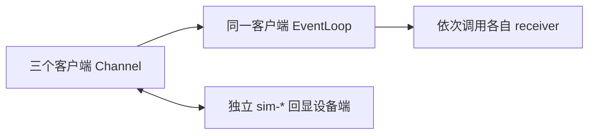
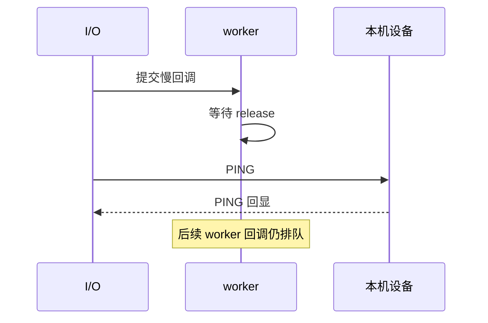
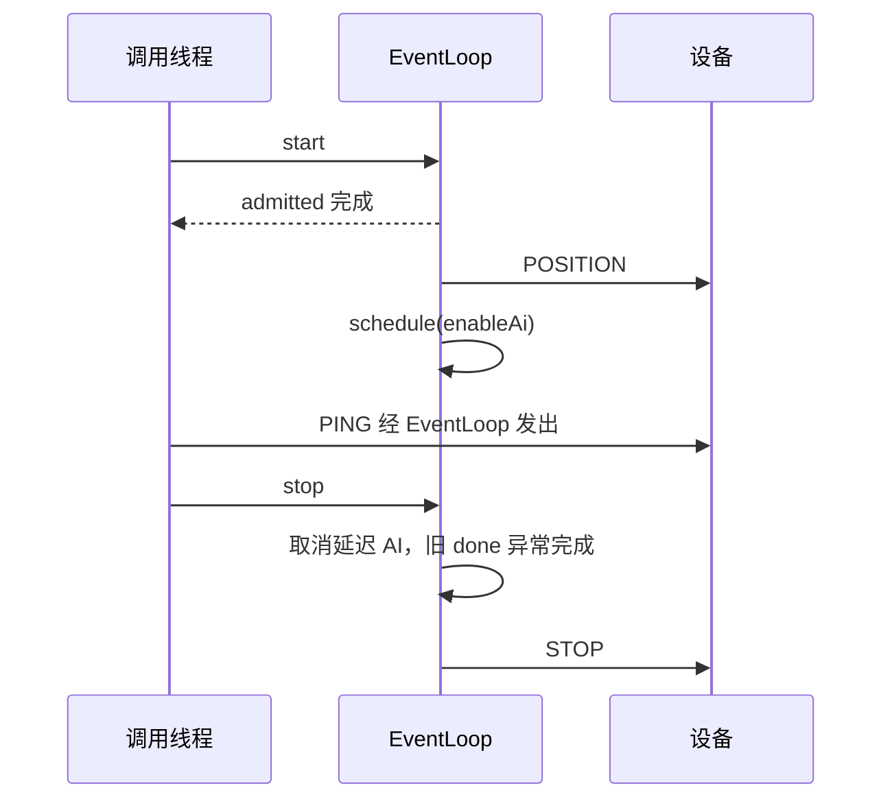
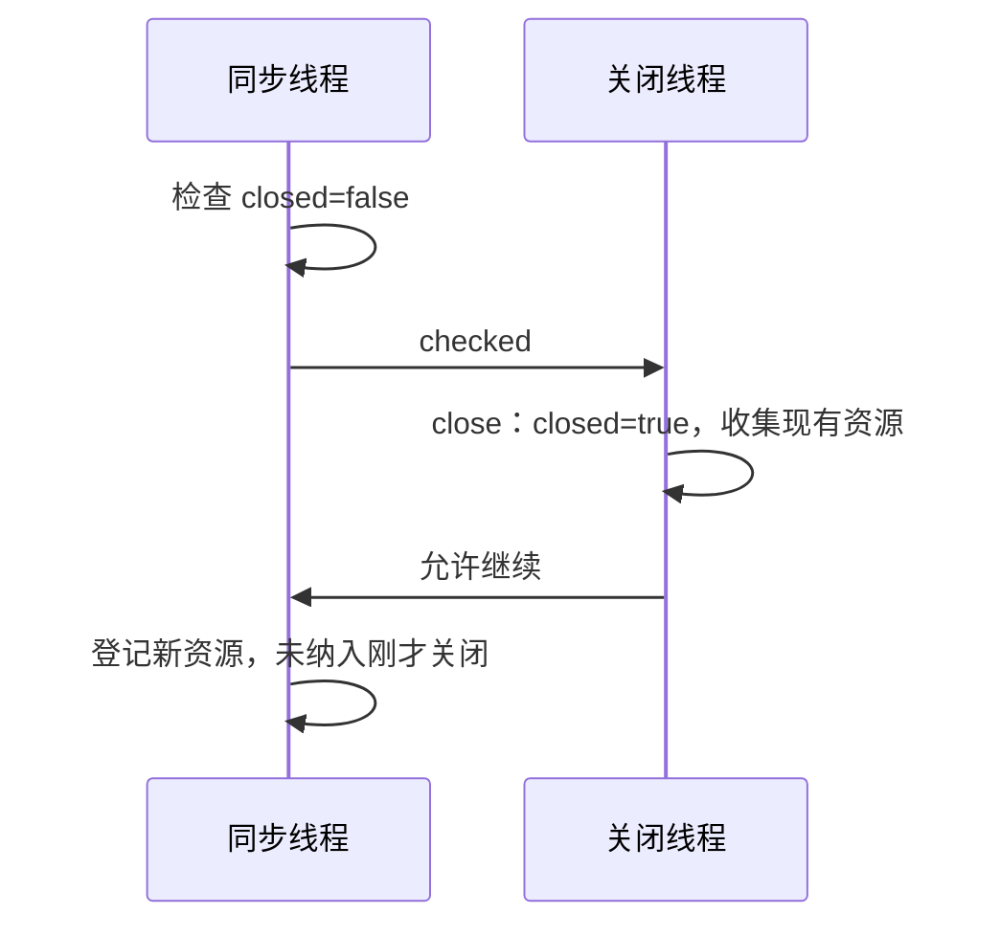
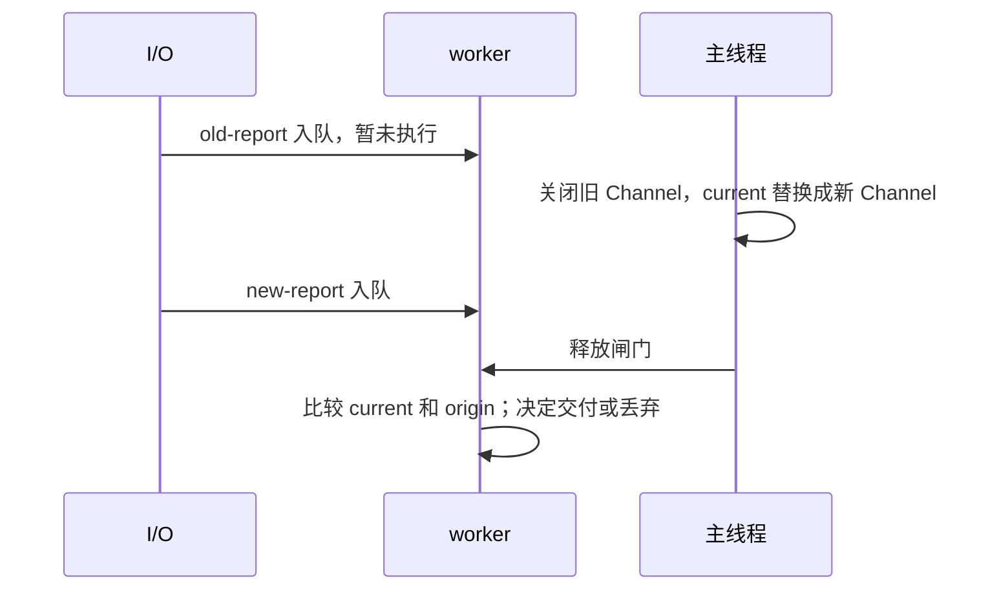
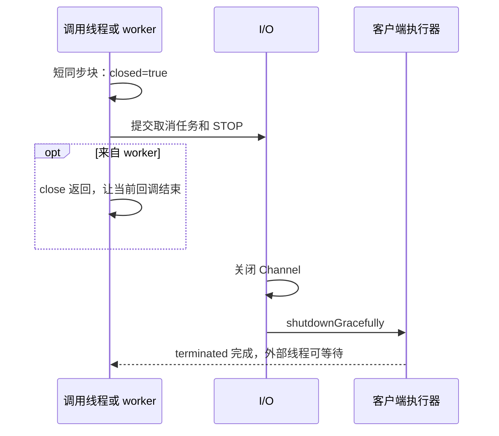

# IDEA 调试指南：从实验回到适配器源码

基线：2026-11-16，`ad-iot-codec-adapter-nnq52xt75@50f1240d3ad7be58e3045b2e290a9c3fecef21fe`。生产路径均相对该适配器仓库的 `src/main/java/com/xmkj/codec/adapter/uav/device/tofums/`；类名与方法名是对照坐标，不依赖本机绝对路径。

## 开始前

若尚不熟悉 Channel、EventLoop、worker、Future 或 latch，先读[组件、概念与用法](concepts-and-usage.md)。它按“技术大类 → 分类主题 → 验证点”映射六项 JUnit 测试，列出了 API 用法和不同完成信号的含义。本页专注断点与时序；源码注释则贴近每一步说明它在哪个线程执行、为什么需要这一步。

1. IDEA 导入实验仓库根 POM，JDK 8 或更高；先按[运行说明](../README.md)执行模块验证。
2. 打开一个 Demo 的 main，先 Run 看完整日志，再 Debug。
3. 在断点右键面板选择 Suspend：**Thread**。观察 worker 暂停而 I/O 继续时尤其重要；All 会把心跳也停住，无法据此判断 worker 是否阻塞 I/O。
4. VM options 推荐 `-Dlab.waitSeconds=300 -Dlab.delayMillis=60000 -Dfile.encoding=UTF-8`。断点不会暂停操作系统时钟；即便 All 暂停，恢复后也可能立即触发已到期定时任务。
5. 场景完成前恢复所有线程，才能观察完整关闭。自动化测试默认上限较短，不适合长时间停在断点上。

日志中的步骤号描述输出先后，不是设备执行确认或全局业务时序。Future 完成、TCP 写出和设备业务效果是不同概念。

## 1. SharedEventLoopDemo：连接对象不等于线程

先运行 `SharedEventLoopDemo`。在接收 lambda 的 `reply.complete(Thread.currentThread())` 设置断点，依次观察 `device`、线程对象与 Channel ID。在 Frames／Threads 中可以看到三条连接都由同一个 `adapter-io-*` 线程处理。

断言还会检查三条 Channel 各自返回本设备的文本。相同执行线程不表示共用了设备身份或当前任务。

生产对照：`TofuMsCustomProtocolAdapter.syncDeviceConnection` 创建 `NioEventLoopGroup(1)`，为各 Session 传入 `io.next()`；`transport/TofuMsSession.connect` 将各 Channel 绑定到所属 EventLoop。

差异：这里是文本回显，没有设备配置、校准、物模型或 TJSON。模拟设备端另有线程，不能把它们计入生产插件的两条核心工作线程。

## 2. CallbackOffloadDemo：慢回调究竟堵住谁

该 main 先执行 `offload=false`，再执行 `true`。`release` 是人为控制慢回调的闸门，代表一次尚未返回的 RPC／消息发送，不通过随机 sleep 制造效果。

断点建议放在慢回调内的 `LabSupport.gate(release)`，只暂停当前线程。

- false：慢回调占住 I/O。主线程安排心跳 PING，但无法发出并处理回显；150ms 观察窗口到期后主线程释放回调，PING 才继续。
- true：慢回调转交 worker；I/O 仍能发出并接收真实 TCP PING。但排在同一个 worker 后面的 `otherCallback` 没有完成，表明卸载没有消除 worker 的串行等待。

生产对照：`TofuMsSession.dispatch` 的 `worker.execute`，以及 `TofuMsCustomProtocolAdapter.upstream` 到网关回调的直接调用链。

差异：实验用一次心跳探针，没有实现生产每 100ms tick、5 秒常规心跳与超时策略。150ms 是受控阻塞的观察窗口，不是性能指标；不要长时间暂停主线程后再用耗时推断生产时延。

## 3. ScheduledSequenceDemo：定时任务没有占着线程睡眠

在 `core/TimedSequence.start` 的 `admitted.complete`、`waiting.complete` 和 `enableAi` 设置断点。观察：

- `admitted`：EventLoop 已受理；`done` 尚未完成。
- `delayedAi`：已注册的定时任务；不是新线程。
- 在延迟期间，POSITION 与 PING 都实际通过 TCP 往返。
- 调用 `stop` 后 `delayedAi.isCancelled()` 为 true，旧 `done` 异常完成；不会写出旧 AI_ON。
- 第二条短序列正常写出 POSITION、AI_ON，最终 `done` 成功。

生产对照：`TofuMsSession.execute/admit/next/write/finish` 和 Execution 的 `admitted/done/scheduled`。

差异：教学模型省略 AI off、水平／俯仰编码、总执行超时、写超时与运动接管规则；`done` 只表示本模型写出完成，不证明云台到位。演示取消路径时请在 `lab.delayMillis` 内继续运行；若人工暂停超过该窗口，AI 可能已执行，取消断言会如实失败。

## 4. LifecycleLockDemo：close 只调用一次，为何还需要锁

优先看这个实验，理解最近代码评审的问题。`LifecycleRegistry` 用假资源代替 Session，避免 TCP 噪声掩盖两个操作之间的交错。

### 无锁：volatile 只能让后续读取看到新值

在 `registerInside` 的 `checked.countDown()` 后打断点：同步线程已经读到 `closed=false`。主线程随后执行一次 close，设置 true 并收集现有资源，再释放 `continueRegistration`。同步线程不会自动重新执行前面的检查，仍然登记资源。所有动作由 latch 安排，稳定得到 `openResources()==1`。

### 有锁：同一个对象的 monitor 协调两个入口

`useMonitor=true` 时，`register` 与 `close` 都锁住同一个 `this`。登记线程在临界区中暂停，关闭线程只能等待它离开。恢复登记后，关闭能收齐资源，`openResources()==0`。

断点可放在 `close` 的 `synchronized(this)` 前，观察 `registry` 与 Threads 中另一条线程。`closeAttempted` 只表示关闭任务已经准备竞争锁，不保证采样那一刻线程状态一定为 BLOCKED。代码不在持锁期间要求另一个线程先完成关闭，因此没有人为制造环形等待。

第三个分支让 close 先完成，再调用 register，直接被终止标记拒绝。

生产对照：`TofuMsCustomProtocolAdapter.syncDeviceConnection` 的 synchronized 方法与 `close` 的同步块；二者使用相同实例 monitor。`closed` 的 volatile 还供锁外下行／回调读取，与互斥职责不同。

差异：锁内 latch 是教学暂停点，模拟操作系统在检查后抢占线程，生产没有这个等待。假资源只验证指定交错，不涵盖真实 Channel 关闭。错误分支在结尾再次清理故意遗漏的假资源，这次清理不属于“一次业务关闭”的演示路径。删除锁并不等于删除所有状态，也不能用本实验推断生产所有竞态都已覆盖。

## 5. StaleCallbackDemo：回调排队后，连接身份可能已变

先用闸门占住 worker，再从旧连接发送 old-report，确认回调已入队；关闭旧 Channel，建立新 Channel 并发送 new-report。恢复 worker 后对比两组结果：

- `checkIdentity=false`：两条都交付，旧回调不会随 TCP 断开自动消失。
- `checkIdentity=true`：`current.get()!=origin`，丢弃旧回调，只交付新连接消息。

在 `connect` 的 worker lambda 中比较 `current.get()` 和 `origin` 的对象身份，使用 Thread 暂停。末尾的空 worker 任务是队列屏障，确保两份回调处理完后再断言，没有靠 sleep 猜测。

这里的 `AtomicReference` 只用 get／set 提供跨线程可见性，不演示 CAS；生产的连接 token 使用 volatile Channel。另一个 expected 引用用于把异步 receiver 与本次建连得到的 Channel 关联，调用者赋值后才发送第一条消息。

生产对照：`TofuMsSession.token/dispatch/Inbound.channelActive`；Adapter.upstream 还会核对当前设备 Context，这一层解决配置代次，不是与 Channel 检查完全重复。

差异：实验由主线程主动换连接，没有完整自动重连、OFFLINE 排序或两份属性／事件报告。它只能丢弃尚未开始的旧回调，已经进入外部系统的调用无法撤回，也不能识别同一连接上跨业务目标迟到的设备消息。

## 6. GracefulCloseDemo：锁外等待与不等待自己

`ClosingRuntime` 只管一个实验 Channel。构造时登记心跳、待执行 AI 和模拟重连任务，随后分别演示普通线程与 worker 内调用 close。

在 `closeAsync` 的同步块、I/O 清理 lambda、`LocalTcpLab.shutdownClientAsync` 设置 Thread 断点。

普通线程会在同步块外等待 terminated；worker 内只发起关闭，然后返回，以便自己的执行器真正终止。观察 `heartbeat/delayedAi/reconnect` 的 cancelled 状态、Channel 的 open 状态，以及重复 closeAsync 返回同一个完成结果。所有客户端执行器退出后，最外层夹具再关模拟设备端。

生产对照：`TofuMsCustomProtocolAdapter.close/trackClose`、`TofuMsSession.closeAsync/closeChannel/safetyStop`。

差异：这里的 reconnect 只模拟调度入口，不创建新连接；STOP 只是文本写出，没有生产关 AI＋云台停止序列。教学模型的 terminated 等待两个客户端执行器终止，比生产 Adapter.close 的有界等待返回语义更直接；不要把本实验的完成承诺外推为生产关闭必定完成。异常 STOP 写入仍继续释放资源，并通过完成结果报告失败。

## 验证与阅读边界

`ConcurrencyScenariosTest` 六个测试直接调用各 Demo 的 run，检查实际事件，不另写一份替代实现。线程等待和清理均有上限，实验没有对毫秒级精确延迟作断言；未覆盖的设备行为和生产竞态不能按“六项通过”推定通过。

先理解这六个小模型，再回到适配器查看完整的配置、协议、超时与失败处理。没有把适配器改成这个教学实现，也没有重新引入已经移除的 started 状态或流量观察接口。
