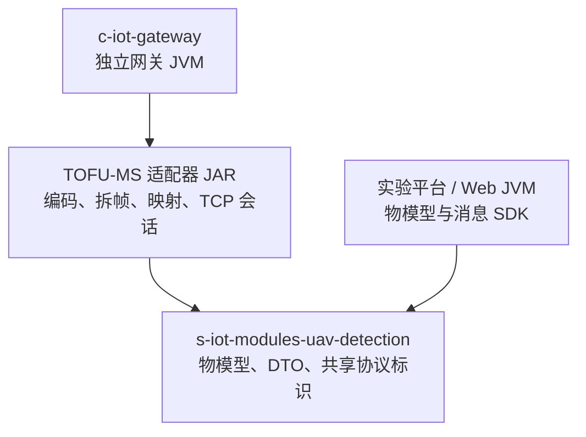
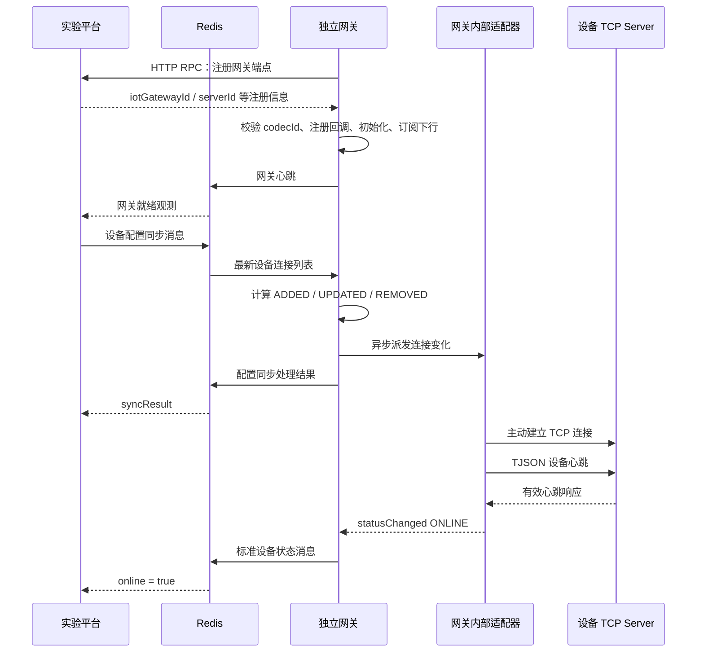
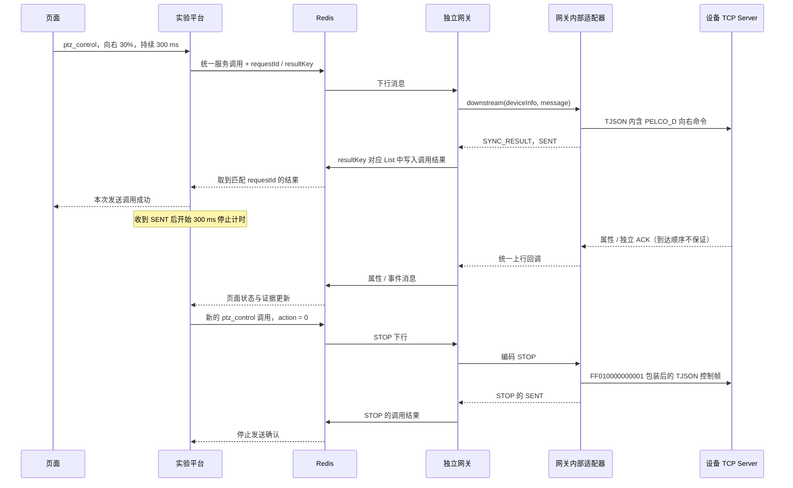

# TOFU-MS 新设备接入网关：职责、数据链路与最小闭环测试案例

本文以当前 TOFU-MS 光电设备的实现为例，说明物模型工程、协议适配器工程、IoT 网关和实验平台如何协作，并给出可以复现的接入验证流程。内容依据当前源码、配置和已有测试报告整理；文中设备编号、报文和地址均为实验样例。

**本案例的验收链路是：实验平台发起物模型服务调用，经 Redis 交给独立启动的 `c-iot-gateway`，由网关内部的 TOFU-MS 适配器通过 TCP 连接设备，随后将发送结果、设备属性、在线状态和协议 ACK 回传。**

真实平台如何接替模拟职责、产品与设备如何关联，以及侦测业务还需补齐哪些适配，见 [实验链路与完整平台集成对照](tofu-ms-platform-integration-comparison.md)。该文区分已核实源码与尚未验收的第二阶段目标设计。

阅读时先区分两个关系：`s-iot-modules-uav-detection` 提供“统一说什么”，`ad-iot-codec-adapter-uav-detection` 实现“如何转换成设备能理解的协议”；两者都是网关使用的代码依赖。真正运行并与设备通信的服务是 `c-iot-gateway`。实验仓库 `tu-device-platform-kernel-lab` 在这里模拟平台侧和设备侧，构成最小测试闭环。

## 1. 四个工程分别负责什么

| 工程 | 本案例的职责 | 主要产物 | 运行方式 |
| --- | --- | --- | --- |
| `s-iot-modules-uav-detection` | 定义设备能力、服务参数、属性、事件、DTO 和共享协议标识 | `TOFU-MS.json`、`ThingModel`、`TofuMsProtocol`、光电 DTO | 作为 Java 依赖使用；物模型工程不是本案例中独立运行的服务 |
| `ad-iot-codec-adapter-uav-detection` | 将统一消息转换为设备报文，将设备报文转换为统一消息；本设备还由适配器维护 TCP 会话 | `ad-iot-codec-adapter-uav-detection-tofu-ms` 子模块 | JAR 加载到网关 JVM 中；没有单独启动一个适配器服务 |
| `c-iot-gateway` | 注册网关、接收配置同步和下行消息、装配适配器、转发上行、处理调用结果和网关生命周期 | 网关 `app.jar`、独立实验入口和配置 | 独立 JVM；是 remote 模式中实际连接设备的进程 |
| `tu-device-platform-kernel-lab` | 模拟平台请求、平台 RPC 和上行消费；提供设备模拟器、页面、控制计时和链路测试 | Web 实验模块、命令客户端、设备模拟器、脚本和测试 | Web 实验平台与设备模拟器分别运行；设备模拟器也可以被真实设备替换 |

实验仓库相关子模块进一步分工：

| 子模块 | 责任 |
| --- | --- |
| `device-platform-tofu-ms-simulator` | 作为设备 TCP Server，独立解析控制报文，回送心跳、ACK 和模拟属性 |
| `device-platform-tofu-ms-command-client` | 提供控制调用与 `TimedOpticalControl`，在发送完成后安排 STOP |
| `device-platform-tofu-ms-gateway-web` | 提供页面与 HTTP API、加载真实物模型、切换 embedded/remote、模拟平台 RPC 和 Redis 消息边界、展示链路证据 |

### 1.1 代码依赖图：不是四个 HTTP 服务串联

箭头表示“使用代码依赖”：



因此，物模型工程不会在下行途中“接收一次 HTTP 请求，再转发给适配器工程”。适配器的方法在网关进程中被调用。修改物模型或适配器后，需要构建依赖并重新打包、启动使用它们的程序，修改源码本身不会自动更新已经运行的 JAR。

### 1.2 运行时流程图：谁实际发送 TCP

```mermaid
flowchart LR
    Browser["浏览器<br/>实验控制页面"]
    Platform["实验平台 JVM<br/>模拟平台 RPC / 下行 / 上行消费"]
    Redis["Redis<br/>消息 Stream + 调用结果 List"]
    subgraph GW["独立 c-iot-gateway JVM"]
        Server["IoTCustomGatewayServer<br/>注册、订阅、配置同步、结果处理"]
        Plugin["TofuMsCustomProtocolAdapter<br/>命令编码、上行映射"]
        Session["TofuMsSession<br/>TCP Client、心跳、发送队列"]
        Server <-->|下行调用 / 上行与状态回调| Plugin
        Plugin <-->|命令帧 / 设备帧与状态| Session
    end
    Device["设备 TCP Server<br/>模拟器 / 真实设备"]
    Browser <-->|HTTP| Platform
    Platform -->|配置同步 / 服务调用| Redis
    Redis -->|下行消息| Server
    Server -->|调用结果 / 标准上行| Redis
    Redis -->|结果 / 状态 / 属性 / 事件| Platform
    Server -->|注册 / 查询设备，HTTP RPC| Platform
    Session <-->|TCP：TJSON 帧| Device
```



本案例运行四个进程：实验平台、Redis、独立网关、设备模拟器。真实设备联调时，设备位置由真实设备 TCP Server 替换。生产平台服务及其数据库没有被这个实验完整启动。

## 2. 先分清“物模型”“适配器”“解码器”

这几个词描述的边界不同：

| 概念 | 回答的问题 | TOFU-MS 中的实现 |
| --- | --- | --- |
| 物模型 | 设备对平台暴露什么能力？参数和单位是什么？ | `TOFU-MS.json`、光电 DTO、`ThingModel` |
| 传输协议 | 字节如何在两个端点之间传送？谁连接谁？ | TCP，网关主动连接设备 |
| 帧协议 / 拆帧器 | 连续字节流中一条完整消息在哪里结束？ | TJSON 帧格式，`TjsonFrame.read` |
| 命令编码器 | 平台的“向右、30% 速度”对应哪些设备字节？ | `TofuMsCommandRegistry`，PELCO_D / VISCA 编码 |
| 上行业务解码 / 映射器 | 设备字段表示哪一个物模型属性或事件？ | `TofuMsUpstreamMapper` |
| TCP 会话 | 何时连接、心跳、写入、断开、重连？ | `TofuMsSession` |
| 协议适配器 | 如何把上述设备实现接到网关的统一接口？ | `TofuMsCustomProtocolAdapter` |
| 网关 | 如何注册、路由、管理配置和统一回传？ | `IoTCustomGatewayServer` 等网关组件 |

“解码”通常至少包括两个阶段：先从 TCP 字节流取出完整帧，再解释帧的业务内容。只把 JSON 转成 Java 对象，不能解决 TCP 半包、粘包、消息长度或设备身份问题。

物模型也不是设备协议说明书的逐字段复制。平台使用 `panAngle`，设备可能使用 `PTZInfoH`；适配器负责这两个语义之间的明确映射。设备报文里的目标坐标也不能直接认定为设备安装坐标。

## 3. 为什么当前是 `customs`，同时本质还是 TCP

**当前 TOFU-MS 使用 `customs` 接入，适配器实现 `CustomProtocolAdapter`，由它自己的 `TofuMsSession` 主动建立设备 TCP 连接。**

`tcps` 和 `customs` 是网关的两种接入装配方式。`customs` 不表示“非 TCP”，也不表示“无需协议配置”。它允许适配器管理设备专有的连接和生命周期。

### 3.1 与原有 sinovatio 接入的对照

| 项目 | sinovatio 的 `tcps` 接入 | 当前 TOFU-MS 的 `customs` 接入 |
| --- | --- | --- |
| 网关配置入口 | `star.iot.gateway.protocol.tcps` | `star.iot.gateway.protocol.customs` |
| 本例协议标识 | `ws-sinovatio-v` | `ws-tofu-ms-v` |
| 核心适配器接口 | `ProtocolCodecAdapter` | `CustomProtocolAdapter` |
| 网络连接管理 | 网关 TCP 接入组件监听并管理连接 | TOFU-MS 适配器主动连接每个已同步设备 |
| 编解码选择 | 通用 `ProtocolCodecAdapterManager` 按元数据 ID 管理 codec | 先按 `customs` 条目的 Bean 名找适配器，再校验其元数据 ID |
| 上行接入 | 网关 TCP 入口将报文交给 codec | 适配器通过 `CustomProtocolAdapterCallback.upstream` 回调网关 |
| 在线状态 | 由对应 TCP 接入和设备识别逻辑处理 | 会话收到有效设备心跳后，通过状态回调上报 |
| 配置中的端口 | TCP 接入组件的监听端口 | 本案例是网关标识配置；设备目标端口另在连接配置中 |

当前网关源码 `IotGatewayConfiguration` 对两者分别装配：`TcpProtocolConfiguration` 创建 `IotTcpUpstreamProtocol` 等组件；`CustomProtocolConfiguration` 使用 `applicationContext.getBean(entry.getKey(), CustomProtocolAdapter.class)`，再创建 `IoTCustomGatewayServer`。

原有 sinovatio 的 `SinovatioTcpCodecAdapter` 实现 `preDecode/decode/encode/getMeta`，其 `SinovatioTcpFrameDecoder` 则只根据长度字段切分帧。这是可参考的职责划分。TOFU-MS 的帧头、会话方向和控制报文不同，不能直接照搬 sinovatio 的帧解析或监听配置。

**本案例参考的是原有设备接入的“模型标识一致、适配器注册、协议配置、消息映射、链路验证”做法，保留已确认的 TOFU-MS 连接方向。** 如果今后设备改成主动连接网关，应重新评估监听方式、身份识别和会话管理，再选择 `tcps` 接入。

## 4. 哪些标识必须一致，哪些不能混用

| 标识 / 参数 | 当前实验值 | 含义与一致性要求 |
| --- | --- | --- |
| `productKey` | `TOFU-MS` | 产品身份；物模型与同步设备信息一致 |
| `protocolCodecId` | `ws-tofu-ms-v` | 网关配置中的协议实现标识；必须与适配器 `getMeta().id` 一致 |
| `TofuMsProtocol.PROTOCOL_CODEC_ID` | `ws-tofu-ms-v` | 物模型工程中的共享常量；TOFU-MS 适配器直接引用，避免另写一份不同的字符串 |
| Custom Bean 名 | `tofuMsCustomProtocolAdapter` | Spring Bean 名；必须与 `customs` 下的配置键一致 |
| `protocolType` | `CUSTOM` | 当前接入分类，不是设备报文中的协议名称 |
| `deviceId` | `7001` | 实验平台分配的模拟设备 ID |
| `deviceName` | `lab-gateway-camera` | 模拟设备名称；与 `productKey` 一起供网关查询和上行识别 |
| `iotGatewayId` | `8001` | 模拟平台注册后返回的网关 ID；用于当前上下行 Topic 构造 |
| `serverId` | 运行时注册信息生成 | 网关端点身份；不是设备 IP，也不是单次调用 ID |
| `requestId` | 每次调用生成 UUID | 关联平台下行与网关调用结果；外层和 `innerIotParams` 中值一致 |
| `channelId` | 字符串 `"1"` | 物模型逻辑控制通道；当前只开放此通道 |
| `ptzAddress` | `1` | PELCO_D 地址字节；不是逻辑通道，也不是视频通道 |
| `host` / `port` | `127.0.0.1` / `8089` | 模拟设备 TCP Server 地址；真实设备测试应换成网关能访问的真实地址 |

`ws-tofu-ms-v` 只是一致的协议实现标识。不能从名称中的 `ws` 推断本设备使用 WebSocket。设备链路实际使用 TCP；TJSON 是它的帧格式，不需要把协议 ID 改成带 `tjson` 后缀的名称。

当前 Custom 适配器的选择路径是：

```text
customs.tofuMsCustomProtocolAdapter
    → 找到同名 CustomProtocolAdapter Bean
    → 校验配置 protocolCodecId == adapter.getMeta().id
    → 处理此网关接入端点收到的配置与调用
```

这里没有“收到任意字节后根据 protocolCodecId 自动猜测厂家”的逻辑。标识的匹配解决装配一致性，帧类型和服务标识的分派发生在后续设备实现内部。

## 5. 物模型定义了哪些能力

当前模型包含 10 个只读属性、3 个控制服务和 1 个协议反馈事件。服务使用统一方法 `thing.service.invoke`，通过 `identifier` 区分能力。

| 服务标识 | 参数 | 当前设备编码 |
| --- | --- | --- |
| `ptz_control` | `channelId:"1"`，`action:0..8`；非 STOP 时 `speedPercent:1..100` | PELCO_D |
| `zoom_control` | `channelId:"1"`，`action:0..2`；非 STOP 时 `speedPercent:1..100` | VISCA 变倍 |
| `optical_focus_control` | `channelId:"1"`，`action:0..2`；固定速度，不接受 `speedPercent` | VISCA 聚焦 |

PTZ 动作含义为：`0` 停止、`1` 左、`2` 右、`3` 上、`4` 下、`5` 左上、`6` 左下、`7` 右上、`8` 右下。变倍的 `1/2` 表示增加/减少；聚焦的 `1/2` 表示远焦/近焦。

10 个属性为 `timestamp`、`panAngle`、`tiltAngle`、`visibleZoom`、`infraredZoom`、`laserRange`、`displayMode`、`cameraDisplayMode`、`northOffset`、`deviceTime`。设备未提供的可选属性不应编造默认值。

`optical_protocol_feedback` 用于上报协议 ACK；当前定义 `0` 正常、`1` 包不完整、`2` 协议内容错误。它是独立事件，不是“云台动作完成”事件。

模型服务的 `callType:sync` 在本实现中对应“同步取得 TCP 发送结果”。不能据此承诺同步等待物理动作结束。

### 5.1 模型 JSON 与实现代码如何协作

Web 实验平台加载 `TOFU-MS.json` 来展示服务目录并校验允许的参数。`ThingModel` 和 DTO 提供 Java 侧的统一类型；设备适配器的命令注册表则显式注册三个服务处理器。

因此，仅在 JSON 中增加一个新服务，不会自动产生设备编码。新增能力至少需要同步考虑：模型与 DTO、命令处理器、上行映射（如果有对应反馈）、界面调用和验证样例。模型定义、设备实际能力和实现边界必须一致。

## 6. 网关配置与设备配置分成两层

### 6.1 网关接入配置：加载什么适配器

当前独立实验配置中的协议部分如下，参数来自现有 YAML：

```yaml
star:
  iot:
    gateway:
      protocol:
        customs:
          tofuMsCustomProtocolAdapter:
            enabled: true
            protocolCodecId: ws-tofu-ms-v
            tags: tofu-ms-local
            port: 18089
            deviceConfigSyncEnabled: true
            deviceProtocolType: CUSTOM
            keepAliveIntervalSeconds: 5
            adapterProperties:
              connectTimeoutMillis: "2000"
              commandTimeoutMillis: "3000"
              commandIntervalMillis: "150"
              queueCapacity: "64"
```

这个配置启用接入端点，关联适配器和协议标识，并设置连接超时、发送超时、写入间隔和队列容量。`deviceConfigSyncEnabled` 表示使用设备配置同步能力；`keepAliveIntervalSeconds` 是网关端点心跳配置，不是设备会话全部心跳参数的统一来源。

**`18089` 在这个独立入口中用于网关身份配置。入口设置 `WebApplicationType.NONE`，不会因此启动一个 18089 HTTP 控制服务；设备目标端口也不是 18089。**

### 6.2 设备连接配置：连接哪一台设备

Web 的连接请求是模拟参数：

```json
{
  "host": "127.0.0.1",
  "port": 8089,
  "ptzAddress": 1,
  "mode": "remote"
}
```

平台侧转换为 `IotDeviceConnectionDTO`。下面展示关键字段，`config` 在 DTO 中实际是 JSON 字符串：

```json
{
  "deviceId": 7001,
  "productKey": "TOFU-MS",
  "deviceName": "lab-gateway-camera",
  "protocolType": "CUSTOM",
  "ip": "127.0.0.1",
  "config": "{\"host\":\"127.0.0.1\",\"port\":8089,\"ptzAddress\":1}"
}
```

当前设备配置支持 `host`、`port`、`enabled`、`ptzAddress`。默认端口 8089、地址 1、启用 true；`host` 缺省时使用 DTO 的 `ip`。实验平台会显式传入目标地址和端口。

所以页面上的“设备 IP”确实是 TCP 目标地址。使用模拟器时它是模拟器地址；切换真实设备时它应是**从网关进程所在机器可达的设备地址**。若网关部署到另一台机器，`127.0.0.1` 指的是那台网关机器本身，不能继续把它当作浏览器所在机器。

### 6.3 为什么有 standalone 配置，又有 local 名称

当前只保留 `application-tofu-ms-standalone.yaml` 作为本案例独立网关入口的配置；旧的 `application-tofu-ms-local.yaml` 已移除。

另外存在 Maven 构建 Profile `tofu-ms-local`，用来选择 TOFU-MS 依赖、独立入口源码和相应测试。它是**构建开关**；Spring Profile `tofu-ms-standalone` 是**运行入口的配置开关**，两者不是两套 YAML。

独立入口显式装配已有网关注册、Custom 接入、Redis 总线和结果组件，用本地服务发现指向模拟平台，隔离通常生产启动所依赖的外部环境。它没有另造一套 HTTP 直连设备的控制通路。

## 7. 启动到上线：控制前先建立配置闭环



需要分别判断三种状态：

1. **网关就绪**：注册成功且网关心跳有效；说明平台与网关通路可用。
2. **配置同步成功**：网关已处理设备列表并提交连接变化任务；连接回调是异步执行的，此结果不保证 Socket 已建立。
3. **设备在线**：适配器会话收到有效设备心跳，并经网关上报状态；这是当前设备控制的前置条件。

设备配置同步处理器把完整列表交给连接注册表计算差异。新增设备建立会话，更新设备替换旧会话，移除设备关闭会话。本实验断开时同步空列表，因为它只保留一个测试目标；不能把“空列表”的含义误解成“保留所有设备”。

### 7.1 两条心跳链路

| 心跳 | 路径 | 当前用途 |
| --- | --- | --- |
| 网关心跳 | 网关 → Redis → 实验平台 | 平台确认独立网关仍可用；本实验超过约 12 秒未收到匹配心跳即不再视为 ready |
| 设备心跳 | `TofuMsSession` ↔ 设备 TCP Server | 首次有效回包确认设备 online；会话正常约每 5 秒发心跳，缺回包时约 1 秒再探测，约 15 秒无有效回包断开 |

当前会话还会在连接失败或断开后约 1 秒再尝试连接。设备会话的重连与“独立网关进程重启后是否重新同步目标”是两件事：前者由适配器处理，后者在实验平台中要求显式操作，见第 11 节。

## 8. 一次“向右移动 300 ms”的完整下行

以下只使用模拟设备：通道 `"1"`、PELCO_D 地址 `1`、向右动作 `2`、速度 `30%`。

### 8.1 页面提交的是实验 API 请求

```json
{
  "identifier": "ptz_control",
  "params": {
    "channelId": "1",
    "action": 2,
    "speedPercent": 30
  },
  "durationMillis": 300
}
```

`durationMillis` 是实验控制器安排 STOP 的参数，当前范围 `100..10000` ms，**不属于设备物模型服务的输入参数**。平台不会把它当成设备已支持“运动固定时长”的指令；适配器也不会自己按它安排停止。

### 8.2 平台封装统一消息，经 Redis 发给网关

下面是教学用精简消息；实际发送还包含运行时 `serverId` 和 `innerIotParams` 等字段：

```json
{
  "deviceId": 7001,
  "iotGatewayId": 8001,
  "requestId": "lab-right-001",
  "method": "thing.service.invoke",
  "params": {
    "identifier": "ptz_control",
    "params": {
      "channelId": "1",
      "action": 2,
      "speedPercent": 30
    }
  }
}
```

`RemoteGatewayControlTransport` 为每次调用生成 requestId，并在 `innerIotParams` 中携带相同 requestId、结果键、结果保留时间和请求到期时间。当前实验配置为结果保留 30 秒、请求到期时间为发起后约 5 秒，等待结果最多 6 秒。

消息通过 SDK 的 `IotRedisMessageBus` 写入下行 Stream。Topic 使用 `IotDeviceMessageUtils.buildTopicForMessageDownstream(iotGatewayId)` 构造，网关订阅对应 Topic。调用结果使用另一个 Redis List；不能把结果 List 与设备上行 Stream 混为同一种回包。

### 8.3 网关识别设备并调用适配器

`CustomDownstreamProcessor` 处理普通调用时，按 deviceId 查询设备缓存/RPC，并取得设备身份和已同步的连接配置；同时检查外层 requestId 与内层关联值是否冲突。

随后 `TofuMsCustomProtocolAdapter.downstream` 检查：适配器可用、设备已配置、设备身份相符；若消息提供的 `expiresAtMillis` 已到期，则在编码发送前拒绝请求。离线会话不接受运动命令。

### 8.4 命令注册表把物模型参数编码成设备指令

`TofuMsCommandRegistry` 先验证方法为 `thing.service.invoke`，再按服务 `identifier` 选择处理器。

向右速度的映射为：

```text
PELCO_D 速度 = max(1, (speedPercent × 63 + 50) / 100)，整数除法
30% → 19 → 0x13
向右命令字节 = 0x02
校验 = (地址 + 命令 + 水平速度 + 垂直速度) & 0xFF
     = (1 + 2 + 19 + 0) & 0xFF = 0x16
```

生成 7 字节 PELCO_D 命令：

```text
FF 01 00 02 13 00 16
│  │  │  │  │  │  └─ 校验
│  │  │  │  │  └──── 垂直速度 = 0
│  │  │  │  └─────── 水平速度 = 0x13
│  │  │  └────────── 向右
│  │  └───────────── 命令字节 1
│  └──────────────── PELCO_D 地址
└─────────────────── 同步字节
```

再包装为设备的串口控制 JSON：

```json
{"ControlType":"SerialControl","SerialType":"PELCO_D","SerialData":{"Lens":7,"Data":"FF010002130016"}}
```

`Lens` 是设备协议中的字段名，当前值是内层串口字节数 `7`；`Data` 是这 7 个字节的十六进制字符串。这不是把 PELCO_D 裸字节直接写入 TCP。

### 8.5 TJSON 封帧后写入设备 TCP Socket

控制 JSON 外还需要一层帧结构：

```text
普通帧 = EC 91 | Type（1 字节）| BodyLength（4 字节，大端）| Body

上述紧凑 JSON 的 UTF-8 长度为 102 字节 = 0x66
控制帧头 = EC 91 03 00 00 00 66
完整控制帧 = 帧头 7 字节 + JSON 102 字节
```

长度计算的是**外层 JSON 的字节数**，不能填内层 PELCO_D 的 7，也不能用带中文内容时的字符数代替 UTF-8 字节数。

`TofuMsSession` 把帧加入有界队列，并按配置间隔写入 Socket。待写条目绑定当前 Socket 和发送截止时间；断开、过期或已取消的条目不继续发送。STOP 会清除同一执行器尚未发送的旧命令，并优先排队。

`write` 与 `flush` 完成后，适配器返回 `OpticalCommandResult`，其 `deliveryState` 为 `SENT`。这只确认应用侧 TCP 写入完成，设备是否已接受或执行仍需其他证据。

### 8.6 网关返回同步结果，实验控制器再发 STOP



STOP 是新的服务调用，有自己的 requestId 和结果；它同样经过独立网关。300 ms 是从平台取得发送确认后开始安排的计时，实际设备动作时长还受到链路延迟、调度和设备执行的影响，不是精准运动时长承诺。

另外两种控制的现有测试样例是：

| 服务 | 非停止样例 | STOP |
| --- | --- | --- |
| PTZ 向右 30% | `FF010002130016` | `FF010000000001` |
| 可见光变倍增加 100% | `8101040727FF` | `8101040700FF` |
| 可见光固定速度远焦 | `8101040802FF` | `8101040800FF` |

表中的命令展示内层串口字节；它们仍需 JSON 和 TJSON 外层包装。VISCA 变倍将百分比映射到 `0..7` 速度档，固定速度聚焦不接受百分比速度。

## 9. 上行如何变成属性、状态和 ACK

### 9.1 TCP 半包和粘包如何处理

TCP 传递连续字节，不保证一次读取对应一个完整业务报文。当前 `TjsonFrame.read` 先读取帧头和长度，再用 `readFully` 读取完整 Body：半包等待后续字节，连续多帧则逐帧读取。

普通 Body 最大 1 MiB。快照使用另一种帧头和规则，当前实现校验并消费完整快照后丢弃，不产生业务图片上报；快照长度上限 8 MiB。不能在 JPEG 数据内部扫描普通帧头来“找下一条消息”。

| 普通帧类型 | 当前含义 | 处理 |
| --- | --- | --- |
| `0x01` | JSON 上行 | 解析对象；当前只将 `ControlType:ZoomInfo` 映射为属性 |
| `0x03` | JSON 控制下行 | 命令编码使用 |
| `0x11` | 设备心跳 | Body 支持空或两个零字节；确认会话在线 |
| `0x12` | 协议 ACK | 必须是两个字节的大端状态码；映射为独立事件 |

未注册的 JSON 业务类型和其他未映射帧不会自动成为物模型属性。格式错误则按当前会话异常路径处理，不会为了继续链路而随意猜测字段或字节序。

### 9.2 属性映射实例

模拟设备发送的业务内容可以是：

```json
{
  "ControlType": "ZoomInfo",
  "PTZInfoH": 12.5,
  "PTZInfoV": -3.0,
  "ZoomInfo": 2.0,
  "PipShow": 2,
  "CamShowMode": 0,
  "CurrentTime": "2026-10-09T10:00:00+08:00"
}
```

实际 TCP 上仍然是 `0x01` TJSON 帧，JSON 不是裸文本消息。映射关系如下：

| 设备字段 | 物模型字段 | 处理约束 |
| --- | --- | --- |
| `PTZInfoH` | `panAngle` | 数值，水平角 |
| `PTZInfoV` | `tiltAngle` | 数值，俯仰角 |
| `ZoomInfo` | `visibleZoom` | 数值，可见光倍率 |
| `ZoomInfoIR` | `infraredZoom` | 可选数值 |
| `LaserRange` | `laserRange` | 可选数值 |
| `PipShow` | `displayMode` | 整数 `0..4` |
| `CamShowMode` | `cameraDisplayMode` | 整数 `0..1` |
| `NorthOffset` | `northOffset` | 数值 `-180..180` |
| `CurrentTime` | `deviceTime` | 带时区偏移的 ISO-8601 字符串 |
| 本地接收时间 | `timestamp` | 接收端当前毫秒时间，不冒充设备时间 |

`TofuMsUpstreamMapper` 生成 `UpstreamDecodedData`，方法为 `thing.property.post`，`params` 是**扁平属性 Map**，例如包含 `panAngle/tiltAngle/visibleZoom`。属性消息不使用事件包装层；缺失的可选字段省略，实验平台保留此前的最新值和各字段更新时间。

适配器从已经同步的设备信息取得 `productKey/deviceName`，而不是把 TCP 对端 IP 当成唯一设备身份。网关回调先检查该设备是否在期望连接表中，再查询设备、补齐 deviceId、网关信息和消息 ID，最后通过上行消息生产者发布到 Redis。

### 9.3 ACK 映射实例

正常 ACK 的完整普通帧为：

```text
EC 91 12 00 00 00 02 00 00
      │              └───┘
      ACK 类型        大端状态码 0
```

它被映射为 `thing.event.post`，关键参数结构为：

```json
{
  "identifier": "optical_protocol_feedback",
  "event": {
    "timestamp": 1791511200000,
    "statusCode": 0
  }
}
```

示例时间戳只是模拟值；真实上报由接收端生成。设备 ACK 没有携带平台的命令 requestId，所以当前实现不会用“最近发出的命令”强行关联 ACK。网关可能补入一个独立上行消息 ID 作为 requestId，这仍不是原下行调用的关联 ID。

### 9.4 三条回传通路应分开观察

| 回传 | 来源 | 平台如何收到 | 可以确认什么 |
| --- | --- | --- | --- |
| 调用结果 `SENT` | 适配器写 Socket 完成后产生 | 网关写 Redis 结果 List，调用方取回 | 网关执行了这次发送并返回匹配结果 |
| 协议 ACK 事件 | 设备 `0x12` 帧 | 适配器回调 → 网关标准上行 → Redis Stream | 收到了设备的协议反馈及状态码 |
| 属性 / 在线状态 | 设备属性帧 / 心跳与连接变化 | 同一标准上行路径 | 收到了遥测数据或当前会话状态 |

物理动作完成还需要可信的设备完成回执、位置/倍率变化和实物观察等证据。本例没有把 `SENT` 或无关联 ACK 升级为动作完成确认。

## 10. “多协议解析”在本案例中有四层含义

### 10.1 平台与设备之间存在不同协议边界

| 链路边界 | 协议 / 机制 | 谁负责 |
| --- | --- | --- |
| 浏览器 ↔ 实验平台 | HTTP + JSON | Web 模块 |
| 网关 → 模拟平台 | HTTP RPC，注册 / 查询设备 | 网关 RPC 组件和实验平台 RPC 实现 |
| 平台 ↔ 网关消息 | Redis Stream + SDK 统一消息 | 消息总线、订阅者、生产者 |
| 网关 → 平台调用结果 | Redis List + requestId / resultKey | 结果存储与调用方 |
| 网关 ↔ 设备 | TCP + TJSON | TOFU-MS 会话与帧处理 |
| 控制 JSON 内层 | PELCO_D / VISCA 的十六进制命令 | 命令注册表与设备串口控制能力 |

### 10.2 一个网关可以装配多个设备协议实现

通用 `ProtocolCodecAdapterManager` 扫描实现 `ProtocolCodecAdapter` 的 Bean，按元数据 ID 建立映射，检查缺失/重复标识，并执行统一编解码入口。Custom 路径则按配置键选取 `CustomProtocolAdapter` Bean，再通过回调接入网关。

这说明网关具有多种协议扩展入口，**不说明当前独立 TOFU-MS 实验加载了所有厂商适配器**。本入口只装配本案例所需能力。

### 10.3 一个设备协议内部还有消息类型分派

TJSON 按 Type 区分属性、控制、心跳和 ACK；属性帧还按 JSON 的 `ControlType` 判断业务含义。这里依据明确协议字段分派，不是根据内容猜测任意报文类型。

### 10.4 同一设备的不同能力使用不同内层协议

`ptz_control` 选择 PELCO_D，`zoom_control/optical_focus_control` 选择 VISCA，再统一封装到 TJSON 控制帧。它们不是三条独立网络连接，当前控制通道也没有开放任意红外镜头能力。

新增厂家、帧类型、服务或内层命令时，应分别在对应层添加明确定义、实现和样例。单纯增加一个 `protocolCodecId` 字符串不能产生编解码能力。

## 11. embedded 与 remote 分别验证什么

| 项目 | embedded | remote：本案例验收模式 |
| --- | --- | --- |
| TOFU-MS 适配器运行位置 | Web 实验平台 JVM | 独立网关 JVM |
| 谁建立设备 TCP Socket | Web 进程内部的适配器 | 独立网关内部的适配器 |
| 是否经过独立网关服务 | 否 | 是 |
| 是否验证平台注册、网关订阅和真实 Redis | 不覆盖完整边界 | 覆盖 |
| 用途 | 快速排查编码、设备协议和控制行为 | 验证新设备接入网关的完整最小链路 |

remote 路径的 `RemoteGatewayControlTransport` 只发送平台消息并等待结果，不创建设备 Socket。网关不可用时不会替代它直连设备。

实验平台只允许一个目标占用。同一个目标需要先 STOP、断开，再切换模式；连接中再次申请另一模式会被拒绝，防止两套适配器同时控制设备。

当前还有这些重要控制边界：

- 同一时间只安排一个执行器运动；手动 STOP 会取消对应自动停止计时。
- 运动发送超时可能意味着结果丢失或写入状态不确定；平台尝试 STOP，不自动重发运动。
- 会话断开会取消旧连接队列，重连不重放旧运动。
- 独立网关重启后，实验平台不自动恢复旧目标或运动；检测注册代次变化后要求显式操作。显式 STOP 可重新同步旧目标、等待上线并发送停止，然后再重新连接测试。
- STOP 失败时保留运动占用状态，页面不会把它展示成已经确认停止；物理运动可能仍在继续。

## 12. 如何从零复现这个最小闭环

以下路径为可替换的本地实验目录示例，不代表实际设备环境。先在 PowerShell 设置四个仓库与本地 Redis 路径：

```powershell
$labRepo = 'C:\lab\tu-device-platform-kernel-lab'
$modelRepo = 'C:\lab\s-iot-modules-uav-detection'
$adapterRepo = 'C:\lab\ad-iot-codec-adapter-uav-detection'
$gatewayRepo = 'C:\lab\c-iot-gateway'
$redisExe = 'C:\lab\redis\redis-server.exe'
$modelFile = Join-Path $modelRepo 'docs\TOFU-MS.json'
$gatewayJar = Join-Path $gatewayRepo 'c-iot-gateway-bootstrap\target\app.jar'
Set-Location -LiteralPath $labRepo
```

要求本地 Java、Maven 和 Redis 可用，并满足各仓库的依赖要求。外部网关验证测试当前按 Windows `java.exe` 启动子进程。`-Offline` 仅适合已经缓存所需 Maven 依赖的环境。

### 12.1 构建模型、适配器、网关与实验平台

```powershell
& .\scripts\build-tofu-ms-chain.ps1 `
    -ModelRepo $modelRepo `
    -AdapterRepo $adapterRepo `
    -GatewayRepo $gatewayRepo
```

脚本按依赖顺序安装模型、TOFU-MS 适配器和模拟器，使用 `tofu-ms-local` 构建独立网关，再打包 Web 实验平台。网关测试使用实验模拟器，因此构建顺序中模拟器先于网关。

### 12.2 先运行自动化链路验收

```powershell
& .\scripts\verify-tofu-ms-chain.ps1 `
    -ModelFile $modelFile `
    -GatewayJar $gatewayJar `
    -RedisExe $redisExe `
    -RedisPort 16380
```

验证脚本启动独立的临时 Redis，Maven 测试中的 `ExternalGatewayChainTest` 再启动真实网关 JVM，平台和设备在测试内模拟。它测试真实 Redis、RPC、网关装配、TCP、命令字节、STOP、属性/ACK/结果、模式切换及网关关闭/重启。

普通 `mvn test` 没有提供 `tofu.gateway.jar` 时，外部进程测试会条件跳过。验收必须检查该测试 **执行且 Skipped 为 0**，不能只凭普通构建绿色认定经过了独立网关。

### 12.3 启动可交互的四进程链路

```powershell
& .\scripts\start-tofu-ms-chain.ps1 `
    -ModelFile $modelFile `
    -GatewayJar $gatewayJar `
    -RedisExe $redisExe `
    -RedisPort 16379 `
    -PlatformPort 18090 `
    -DevicePort 8089
```

| 默认值 | 用途 |
| --- | --- |
| `127.0.0.1:18090` | 实验页面、API、模拟平台注册/查询 RPC |
| `127.0.0.1:16379` | 交互实验 Redis |
| `127.0.0.1:8089` | 设备模拟器监听端口 |
| 配置值 `18089` | 独立网关身份端口值；本入口不启动此端口的 Web 控制服务 |
| `127.0.0.1:16380` | 自动化验证默认临时 Redis，避免与交互实验互相干扰 |

打开 [本地实验页面](http://127.0.0.1:18090/)，选择独立网关模式，以 `127.0.0.1:8089` 和地址 `1` 连接模拟设备，等待网关 ready 与设备 online，再测试向右、变倍、聚焦和 STOP。

### 12.4 可以用 API 复现一条控制

```powershell
$platformUrl = 'http://127.0.0.1:18090'
$targetBody = @{host='127.0.0.1'; port=8089; ptzAddress=1; mode='remote'} | ConvertTo-Json
Invoke-RestMethod -Method Post -Uri "$platformUrl/api/connect" `
    -ContentType 'application/json' -Body $targetBody
Invoke-RestMethod -Uri "$platformUrl/api/state"
```

确认返回状态中 `gateway.ready` 和 `online` 均为 true 后再发送：

```powershell
$moveBody = @{
    identifier='ptz_control'
    params=@{channelId='1'; action=2; speedPercent=30}
    durationMillis=300
} | ConvertTo-Json -Depth 5
Invoke-RestMethod -Method Post -Uri "$platformUrl/api/invoke" `
    -ContentType 'application/json' -Body $moveBody
Invoke-RestMethod -Uri "$platformUrl/api/state"
```

观察记录中的下行调用、运动的 `SENT`、TX/RX 帧、属性、ACK，稍后应出现新的 STOP 下行和 STOP 的 `SENT`。这些异步记录的相对到达顺序不作保证。

完成后断开并停止本次脚本创建的进程：

```powershell
Invoke-RestMethod -Method Post -Uri "$platformUrl/api/disconnect" `
    -ContentType 'application/json' -Body '{}'
& .\scripts\stop-tofu-ms-chain.ps1
```

停止脚本也会尝试通过实验平台断开；若网关已经不可用，STOP 不能保证送达设备。它依据保存的 PID 和启动时间识别自己的进程，端口被其他进程占用时启动脚本会报错。

### 12.5 替换为真实设备时，变更的是哪个边界

保持 remote 模式，修改设备连接请求中的 `host/port/ptzAddress`，让独立网关连接真实 TCP Server。先确认现场设备协议和已实现命令一致，再执行短时控制和 STOP，并核对属性变化、设备反馈和实物动作。

真实设备测试验证的是协议与物理行为；本案例的平台注册和数据消费仍由实验平台模拟。生产平台注册、授权、存储、业务订阅等需要在完整平台环境中另行验收，不能由本实验的结果直接推出。

## 13. 接入另一种新设备时，可以复用哪些步骤

### 13.1 确认协议证据和最小能力

先取得设备协议说明和独立报文样例，明确连接方向、帧边界、字节序、设备身份、心跳、命令参数、反馈关联方式和停止行为。选一个下行服务、一个上行属性以及必要的状态/反馈，作为第一条闭环。

本设备的最小闭环是“连接与心跳 → PTZ 向右 → 发送结果 → 属性/ACK → STOP → 断开”。变倍和聚焦是在相同基础链路上扩展的两个能力。

### 13.2 在物模型工程定义统一契约

定义 productKey、共享协议 ID、属性、服务、事件和 DTO。重点确认单位、枚举、类型、可选字段、停止参数，以及同步结果究竟确认到哪一步。

例如 `channelId` 是字符串就应全链路使用字符串；固定速度聚焦不应为了统一界面而额外添加设备不支持的速度参数。协议没有命令关联序号时，也不要定义成“可以可靠等待本次命令 ACK”。

### 13.3 在适配器工程实现协议边界

按设备连接特点选择 `ProtocolCodecAdapter` 或 `CustomProtocolAdapter`。本例的 Custom 实现拆为：

```text
TofuMsCustomProtocolAdapter   网关接口、身份检查、配置变更、回调、结果
├─ TofuMsDeviceConfig         每台设备连接参数
├─ TofuMsCommandRegistry      服务分派、参数检查、PELCO_D / VISCA、封帧
├─ TjsonFrame                 字节流帧读取、长度和格式检查
├─ TofuMsUpstreamMapper       属性与协议反馈事件映射
└─ TofuMsSession              Socket、心跳、在线、队列、发送期限与重连
```

使用 `TofuMsAutoConfiguration` 注册命令表、映射器和命名适配器 Bean；本模块在 `META-INF/spring/org.springframework.boot.autoconfigure.AutoConfiguration.imports` 声明自动配置类，独立实验入口也显式导入它。仅把类放入 JAR，并不等于网关已创建可用的 Bean。

应使用独立预期字节样例检查编码，不要让模拟器调用同一个编码器计算“正确答案”。本例模拟器独立接收与校验报文，链路测试也断言预期的内层十六进制字节。

### 13.4 在网关装配依赖和协议配置

确保构建实际包含新适配器模块，协议 ID 与模型常量一致，Bean 名与 Custom 配置键一致，启用正确接入方式。设备目标地址由设备配置同步传入，不写死成网关自身端口。

若使用 `tcps`，需要配置实际监听、设备身份识别和对应 codec；若使用 `customs`，需要实现连接同步、下行结果和上行/状态回调。二者都必须把注册、配置和消息链路纳入验证。

### 13.5 在实验仓库完成可重复验证

推荐按以下顺序推进，每层都保留能判断问题所在的证据：

1. 模型与 DTO 的参数边界测试。
2. 协议样例测试：黄金字节、半包/连续帧、非法长度、字段类型、可选字段、ACK 语义。
3. 独立设备模拟器：作为正确连接方向上的对端，记录实际收到的帧。
4. 网关组件测试：配置差异、身份检查、结果语义、生命周期、到期命令拒绝。
5. 真实消息中间件 + 独立网关 JVM 测试：下行确实经过网关，上行和结果确实回到平台。
6. 断链测试：停止网关或断开 TCP，验证无旁路、无运动重放、STOP 失败状态可见。
7. 用真实设备替换模拟器：核对设备反馈和物理行为。
8. 完整平台环境验收：进一步确认真实注册、权限、状态消费、属性存储和业务功能。

这一流程可以作为新的设备接入模板；具体帧规则、命令和应答能力仍应以新设备证据为准，不能直接套用 TOFU-MS 的动作枚举或超时参数。

## 14. 当前有哪些已验证证据，证明到什么范围

本文编写时检查到以下已有 Surefire 报告：模拟器 2 项、命令客户端 6 项、Web 集成 5 项、外部网关链路 1 项，合计 14 项，Failures/Errors/Skipped 均为 0。外部网关测试确实执行，未条件跳过。这是已有验证记录，本次文档整理没有重新启动设备或重跑运行测试。

| 证据 | 实际检查 | 不能据此推出 |
| --- | --- | --- |
| 独立网关注册与心跳 | 实际网关 JVM 对模拟平台 RPC 注册，经 Redis 上报心跳 | 完整生产平台注册与权限已经验收 |
| 模拟器接收记录 | 三种控制与 STOP 的实际内层字节、停止间隔 | 真实设备电机或镜头完成了动作 |
| 调用结果记录 | 匹配 requestId、成功码及 `SENT`，运动和 STOP 各自有结果 | ACK 与该 requestId 关联，或动作完成 |
| 属性 / ACK / TX_FRAME / RX_FRAME | 上行映射和观测通路存在、属性为扁平结构、ACK 为独立事件 | 所有设备业务帧和图片能力已实现 |
| 模式切换 | remote 与 embedded 互斥，不同时产生两条设备连接 | 生产平台多设备并发能力完整验证 |
| 杀掉独立网关 | 设备连接断开，remote 不能旁路发送 | TCP 断开就保证物理设备自动停止 |
| 重启网关 | 不自动恢复目标或运动，显式 STOP 后才恢复测试连接 | 所有生产恢复策略适用本案例策略 |

实验中的帧观测使用单独的 `tofu:lab:traffic` Stream，方法为 `lab.tcp.frame`，用于页面展示帧十六进制和 JSON。它是独立入口的诊断扩展，不是 TOFU-MS 物模型服务或设备协议，也不是生产平台已经存在的通用抓包接口。快照不进入此观测。

测试产生的 `target/external-gateway-evidence.json` 和 `target/external-gateway-chain.log` 可用于检查本次运行；重新构建、测试后内容会变化。维护时以重新执行验证脚本并检查报告为准，不把本文中的通过数量当作永久保证。

## 15. 遇到问题时按哪条边界定位

| 现象 | 最小检查证据 | 优先检查位置 |
| --- | --- | --- |
| 网关启动失败 / codecId 不匹配 | 网关启动日志、打包依赖、YAML、`getMeta().id` | 适配器装配、共享常量、协议配置 |
| 页面 gateway.ready 为 false | 注册 RPC 是否成功、注册返回、Redis 心跳与实例身份 | 独立入口、模拟平台、Redis |
| 配置同步成功但设备仍 offline | 连接差异日志、异步回调异常、目标 host/port、TCP 心跳回包 | 连接同步与 `TofuMsSession` |
| 服务参数被拒绝 | 当前模型输入定义、页面请求、注册表参数规则 | 物模型与 Web 校验；然后适配器校验 |
| 下行记录存在但模拟器没收到 | 网关是否消费、设备是否已同步、到期检查、会话/队列异常 | 网关下行处理、适配器、TCP |
| 已收到 SENT 但没有动作 | 实际 TX 字节、设备协议反馈、地址、实物状态 | 设备协议参数与现场设备；SENT 只到发送边界 |
| 没有属性 / 某些字段不更新 | RX 帧 Type、ControlType、字段类型、可选值、设备身份 | 拆帧、映射器、上行转发 |
| ACK 无法匹配命令 | ACK 原始字段是否具有命令关联 ID | 协议契约；当前 TOFU-MS 不强行匹配 |
| 调用等待超时 | 结果键/requestId、网关结果处理、Redis List、运行代次 | 同步结果通路；命令执行状态可能未知 |
| STOP 失败 | 网关是否在线、设备心跳、STOP 的 TX 和结果 | 先确认停止送达，保留未确认状态 |
| 重启后运动被拒绝 | 注册 generation 是否变化、旧目标是否仍占用 | 实验平台的显式恢复策略 |

定位时先看边界上的实际消息和日志，再追踪最小调用路径。不能为了让页面变绿，把“配置已接收”当“设备已上线”，也不能在网关失效后添加自动直连旁路来掩盖链路问题。

## 16. 源码阅读入口

下列链接指向当前工作区，便于从本文直接打开证据；换一套目录时按相同工程名和源码路径定位。

### 16.1 物模型工程

- [TOFU-MS.json](D:/workspace/xm-new/s-iot-modules-uav-detection/docs/TOFU-MS.json)：属性、服务参数、结果、ACK 事件定义。
- [TofuMsProtocol.java](D:/workspace/xm-new/s-iot-modules-uav-detection/src/main/java/com/xmkj/sdk/enums/optical/TofuMsProtocol.java)：产品和协议共享常量。
- [ThingModel.java](D:/workspace/xm-new/s-iot-modules-uav-detection/src/main/java/com/xmkj/sdk/enums/ThingModel.java)：统一能力、DTO 与消息方法的关联。

### 16.2 适配器工程

- [TofuMsCustomProtocolAdapter.java](D:/workspace/xm-new/ad-iot-codec-adapter-uav-detection/ad-iot-codec-adapter-uav-detection-tofu-ms/src/main/java/com/xmkj/codec/adapter/uav/device/tofums/TofuMsCustomProtocolAdapter.java)：Custom 接口、配置变化、下行检查、发送结果和回调。
- [TofuMsAutoConfiguration.java](D:/workspace/xm-new/ad-iot-codec-adapter-uav-detection/ad-iot-codec-adapter-uav-detection-tofu-ms/src/main/java/com/xmkj/codec/adapter/uav/device/tofums/autoconfigure/TofuMsAutoConfiguration.java)：适配器 Bean 装配。
- [TofuMsDeviceConfig.java](D:/workspace/xm-new/ad-iot-codec-adapter-uav-detection/ad-iot-codec-adapter-uav-detection-tofu-ms/src/main/java/com/xmkj/codec/adapter/uav/device/tofums/config/TofuMsDeviceConfig.java)：每台设备连接参数。
- [TofuMsCommandRegistry.java](D:/workspace/xm-new/ad-iot-codec-adapter-uav-detection/ad-iot-codec-adapter-uav-detection-tofu-ms/src/main/java/com/xmkj/codec/adapter/uav/device/tofums/command/TofuMsCommandRegistry.java)：服务分派、PELCO_D / VISCA 编码。
- [TjsonFrame.java](D:/workspace/xm-new/ad-iot-codec-adapter-uav-detection/ad-iot-codec-adapter-uav-detection-tofu-ms/src/main/java/com/xmkj/codec/adapter/uav/device/tofums/transport/TjsonFrame.java)：帧头、长度、心跳/ACK 和快照边界。
- [TofuMsSession.java](D:/workspace/xm-new/ad-iot-codec-adapter-uav-detection/ad-iot-codec-adapter-uav-detection-tofu-ms/src/main/java/com/xmkj/codec/adapter/uav/device/tofums/transport/TofuMsSession.java)：TCP 会话、心跳、队列和不重放策略。
- [TofuMsUpstreamMapper.java](D:/workspace/xm-new/ad-iot-codec-adapter-uav-detection/ad-iot-codec-adapter-uav-detection-tofu-ms/src/main/java/com/xmkj/codec/adapter/uav/device/tofums/mapper/TofuMsUpstreamMapper.java)：属性和独立 ACK 事件映射。
- [SinovatioTcpCodecAdapter.java](D:/workspace/xm-new/ad-iot-codec-adapter-uav-detection/ad-iot-codec-adapter-uav-detection-sinovatio/src/main/java/com/xmkj/codec/adapter/uav/device/sinovatio/tcp/SinovatioTcpCodecAdapter.java)、[SinovatioTcpFrameDecoder.java](D:/workspace/xm-new/ad-iot-codec-adapter-uav-detection/ad-iot-codec-adapter-uav-detection-sinovatio/src/main/java/com/xmkj/codec/adapter/uav/device/sinovatio/tcp/codec/SinovatioTcpFrameDecoder.java)：参考设备的 codec 与拆帧职责。

### 16.3 网关工程

- [IotGatewayConfiguration.java](D:/workspace/xm-new/c-iot-gateway/c-iot-gateway-core/src/main/java/com/xmkj/common/iot/gateway/autoconfigure/IotGatewayConfiguration.java)：`tcps/customs` 两条装配路径。
- [ProtocolCodecAdapterManager.java](D:/workspace/xm-new/c-iot-gateway/c-iot-gateway-core/src/main/java/com/xmkj/common/iot/gateway/core/manager/ProtocolCodecAdapterManager.java)：通用 codec 注册与选择。
- [IoTCustomGatewayServer.java](D:/workspace/xm-new/c-iot-gateway/c-iot-gateway-core/src/main/java/com/xmkj/common/iot/gateway/protocol/custom/IoTCustomGatewayServer.java)：协议标识校验、回调与下行订阅。
- [CustomDownstreamProcessor.java](D:/workspace/xm-new/c-iot-gateway/c-iot-gateway-core/src/main/java/com/xmkj/common/iot/gateway/protocol/custom/CustomDownstreamProcessor.java)、[CustomDeviceConnectionDispatcher.java](D:/workspace/xm-new/c-iot-gateway/c-iot-gateway-core/src/main/java/com/xmkj/common/iot/gateway/protocol/custom/CustomDeviceConnectionDispatcher.java)：配置同步、异步连接变化和普通服务调用。
- [GatewayDownstreamSubscriber.java](D:/workspace/xm-new/c-iot-gateway/c-iot-gateway-core/src/main/java/com/xmkj/common/iot/gateway/core/handler/downstream/GatewayDownstreamSubscriber.java)：统一下行结果处理。
- [CustomUpstreamCallbackHandler.java](D:/workspace/xm-new/c-iot-gateway/c-iot-gateway-core/src/main/java/com/xmkj/common/iot/gateway/protocol/custom/CustomUpstreamCallbackHandler.java)、[IotDeviceMessageForwardAdapter.java](D:/workspace/xm-new/c-iot-gateway/c-iot-gateway-core/src/main/java/com/xmkj/common/iot/gateway/adapter/outbound/device/IotDeviceMessageForwardAdapter.java)：设备身份校验、上行字段补齐和转发。
- [TofuMsStandaloneApplication.java](D:/workspace/xm-new/c-iot-gateway/c-iot-gateway-bootstrap/src/tofu-ms/java/com/xmkj/common/iot/gateway/tofums/TofuMsStandaloneApplication.java)、[application-tofu-ms-standalone.yaml](D:/workspace/xm-new/c-iot-gateway/c-iot-gateway-bootstrap/src/main/resources/application-tofu-ms-standalone.yaml)：独立实验入口和唯一实验 YAML。

### 16.4 实验平台与验证

- [RemoteGatewayPlatform.java](D:/workspace/github/tu-device-platform-kernel-lab/device-platform-tofu-ms-gateway-web/src/main/java/com/tu/deviceplatform/tofumsweb/adapter/RemoteGatewayPlatform.java)：模拟注册/设备查询、Redis、网关心跳与上行订阅。
- [RemoteGatewayControlTransport.java](D:/workspace/github/tu-device-platform-kernel-lab/device-platform-tofu-ms-gateway-web/src/main/java/com/tu/deviceplatform/tofumsweb/adapter/RemoteGatewayControlTransport.java)：配置同步、下行消息、结果等待和显式恢复。
- [TimedOpticalControl.java](D:/workspace/github/tu-device-platform-kernel-lab/device-platform-tofu-ms-command-client/src/main/java/com/tu/deviceplatform/tofumsclient/core/TimedOpticalControl.java)：发送确认后的计时、STOP 和运动互斥。
- [ExternalGatewayChainTest.java](D:/workspace/github/tu-device-platform-kernel-lab/device-platform-tofu-ms-gateway-web/src/test/java/com/tu/deviceplatform/tofumsweb/ExternalGatewayChainTest.java)：独立网关进程的整条链路与故障验证。
- [build-tofu-ms-chain.ps1](D:/workspace/github/tu-device-platform-kernel-lab/scripts/build-tofu-ms-chain.ps1)、[verify-tofu-ms-chain.ps1](D:/workspace/github/tu-device-platform-kernel-lab/scripts/verify-tofu-ms-chain.ps1)、[start-tofu-ms-chain.ps1](D:/workspace/github/tu-device-platform-kernel-lab/scripts/start-tofu-ms-chain.ps1)、[stop-tofu-ms-chain.ps1](D:/workspace/github/tu-device-platform-kernel-lab/scripts/stop-tofu-ms-chain.ps1)：构建、验证、交互启动和清理入口。

Workbench 的 [TOFU-MS 独立网关控制链路](D:/workspace/github/tu-engineering-workbench/products/company/device-detection-platform/flows/tofu-ms-gateway-chain.md) 保留当前链路的汇总与验收说明；本文在实验仓库详细讲解实现和新设备接入流程。阅读建议：先看职责与运行图，再看配置和具体字节转换，最后按照第 12 节复现并使用第 15 节定位问题。
