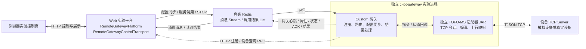
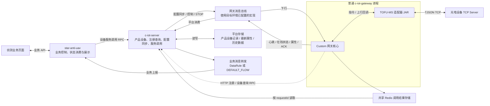
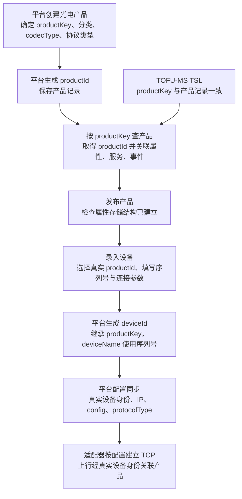
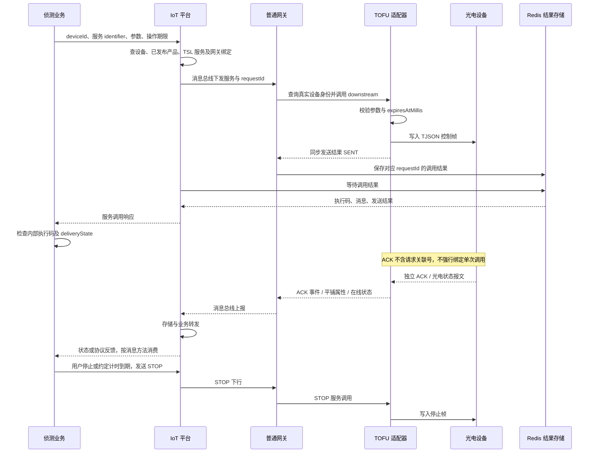

# TOFU-MS：实验网关闭环与完整平台集成对照

本文承接[网关接入案例](tofu-ms-gateway-integration-case.md)，对照已实现的实验链路和第二阶段的正式平台集成设计。源码核对日期：2026-10-09。

**集成方案可行：真实平台可以接替实验平台的注册、设备查询、配置同步和服务调用职责，沿用现有网关与独立 TOFU-MS 适配器。当前仍需补齐设备协议登记、正式构建依赖及侦测业务适配，不能仅替换配置就宣称系统集成完成。**

状态边界：实验链路已有独立网关与模拟设备验证记录，详见接入案例；本页对正式链路的结论来自源码核对。真实产品和设备录入、完整平台启动、存储及业务展示尚未在本次预研中验收。以下目标图表示推荐设计，不表示已部署。

## 1. 当前实验链路：平台数据由 Web 工具模拟

Web 工具返回模拟设备身份和网关 ID，接收注册与设备查询 RPC，并发布连接配置。网关心跳由真实网关组件发送，Web 工具消费它以判断实验网关是否就绪；Redis 传输和调用结果也是现有组件的实际执行，不是页面生成的假结果。

实验平台提供的计时 STOP、目标占用和重启后显式恢复属于实验控制逻辑，不会因替换平台注册接口而自动进入侦测业务。

## 2. 正式集成目标：真实平台接替模拟边界

网关与平台的消息总线类型、实例、主题及消息 SDK 需匹配；同步调用结果还依赖双方一致的 Redis 结果存储。不能直接将实验 Redis 配置覆盖已有正式环境配置。

平台当前既支持 DataRule 目的端转发，也支持无匹配规则时的 `DEFAULT_FLOW` 转发。源码中的兜底通过 `IotMessageBus` 发布；RocketMQ DataRule 目的端则使用独立的 Producer。需要核对目标环境的实际实现及业务消费契约，不能仅凭实验使用 Redis 就推断业务侧的传输方式。

物模型与适配器都是代码依赖，不是运行时链路中的独立 HTTP 服务。产品、TSL 和设备录入则属于平台数据配置。

## 3. 模拟职责与正式职责对照

| 能力 | 当前实验实现 | 正式集成责任与差异 |
| --- | --- | --- |
| 网关注册 | Web RPC 返回模拟网关 ID | `c-iot-server` 创建或更新真实网关记录，并建立上行订阅 |
| 设备查询 | Web 返回固定模拟设备身份 | 平台查询真实设备与产品，并返回产品 codec 信息 |
| 网关心跳 | 网关发送，Web 消费并展示 ready | 网关继续发送，平台更新心跳并触发配置同步 |
| 连接配置 | Web 控制目标 host、port 等参数 | 平台依据设备协议类型同步真实设备连接信息 |
| 下行控制 | 实验页面直接驱动实验传输层 | 业务调用平台服务 RPC，经消息总线抵达网关 |
| 同步结果 | Web 按 requestId 读取 Redis List | 平台按相同结果契约等待，业务检查内部执行码与数据 |
| 属性 | Web 展示平铺属性 Map | 平台按 TSL 筛选和存储，业务补光电属性消费与展示 |
| 协议 ACK | Web 展示独立事件 | 平台记录并转发，业务按独立协议反馈接收 |
| STOP | 实验命令客户端计时发送 | 业务明确停止触发、失败反馈和操作期限 |
| 身份 | 固定模拟设备和网关 ID | 使用平台真实 ID；不得沿用模拟 ID |

## 4. 产品、物模型、设备如何关联

| 标识 | 含义 | 当前事实与集成要求 |
| --- | --- | --- |
| `productId` | 平台产品数据库 ID | 创建产品后生成；适配器不应硬编码它 |
| `productKey` | 产品唯一标识 | 当前 TSL 已有 `TOFU-MS`，但平台产品尚未录入；若采用平台生成值，导入 TSL 要对齐实际值 |
| `protocolCodecId` / 产品 `codecType` | 协议实现选择 | TOFU 实现 ID 为 `ws-tofu-ms-v`；与产品和网关相关配置保持一致 |
| `protocolType` | 设备分类与配置同步筛选条件 | 实验使用 `CUSTOM`；建议正式登记独立 TOFU 设备协议值，具体值待实施时确定 |
| Custom Bean 名 | Spring 适配器装配入口 | `tofuMsCustomProtocolAdapter`，必须与 `customs` 配置键一致 |
| `deviceId` / `deviceName` | 真实设备身份 | 来自平台设备记录；设备名称使用平台序列号规则 |
| `channelId` / `ptzAddress` | 控制通道 / PELCO_D 地址字节 | 两者不同；当前控制通道仅开放字符串 `"1"`，不依赖视频接入 |

TSL 当前包含 10 个属性、3 个同步服务和 1 个 ACK 事件。平台导入实现按 `productKey` 查询真实产品，再关联真实 `productId`；不是靠在模型 DTO 中新增 `productId` 完成路由。产品须先保持未发布以导入，发布后才能创建设备。

文件外层为 `code/msg/data`，接口接收 TSL 本体。页面是否自动提取 `data` 尚需验证。发布成功也不能单独证明历史存储可用：当前创建属性表与写入历史数据的部分异常只记日志，验收必须检查最新属性和历史查询两条路径。

## 5. 控制与反馈的目标时序

此图采用同步等待结果的目标路径；异步调用另按平台现有结果查询契约处理。业务传递操作期限和停止机制仍待补齐，图中不表示当前已有这些行为。

三个证据层次分别是：`SENT` 证明发送边界成功；ACK 证明设备返回协议处理码；角度/倍率变化或现场观察才用于核实实际动作。ACK 不能映射为跟踪锁定成功，也不能保证电机已停止。STOP 失败时应保留未确认状态。

## 6. 已核实的差异与推荐改动

| 工程 | 源码核实结果 | 推荐第二阶段调整 |
| --- | --- | --- |
| `s-iot-modules-uav-detection` | TSL 和共享标识已存在；业务依赖版本与本轮模型分支版本不同 | 对齐真实产品标识和依赖版本；保持单 Jar，不新增平行物模型模块 |
| `c-iot-server` | 已有注册、查询、心跳、配置同步、服务调用和属性存储；设备协议枚举没有 TOFU 或实验 `CUSTOM`，保存接口有枚举校验 | 最小新增专用设备协议及字典登记；录入产品、TSL、设备及必要转发配置；核心上下行流程复用 |
| `c-iot-gateway` | TOFU 依赖仅在 `tofu-ms-local` 构建 profile，默认 `production-adapters` 未包含它 | 将独立适配器纳入正式构建；使用普通入口、服务发现和正式 Custom 配置，预计无需改核心流程 |
| TOFU-MS 适配器 | 使用同步设备身份，已有发送、上行映射和到期拒绝；未发现必须重写协议的证据 | 复用现有独立模块，核对真实配置和 SDK 兼容性 |
| `star-anti-uav` | 聚焦仍调用 `focus_control`；入口按 EventWrapper 解析；通用状态 DTO 不含光电字段；布尔发送结果不检查内部执行码 | 按设备能力路由到 `optical_focus_control`，使用固定速度参数契约；按 method 接收平铺属性并补光电投影、ACK 处理和失败语义，承接停止机制 |

能力路由保留其他设备已有行为，TOFU 聚焦不下发 `speedPercent`；光圈等未实现能力需明确不可用。不能全局替换旧聚焦服务或通用属性类，以免改变其他设备契约。

平台配置同步当前只按设备 `protocolType` 查询，未按产品或网关所有权进一步分区。专用 TOFU 协议值能隔离其他厂商；首轮建议只启用一个负责该协议的网关实例。多个 TOFU 网关如何分配设备仍需单独设计。

独立实验入口包含本地 RPC 限制与模拟服务发现，不能直接改 URL 当成正式入口。正式构建应使用 `IotGatewayServerApplication` 并核对依赖树。物模型分支、业务模型依赖和平台/网关 SDK 版本目前不同，不能只凭版本名称判断二进制兼容。

## 7. 后续验证顺序与完成标准

以下为待实施的验证建议，本次文档维护不启动平台、写入数据库或发送真机指令。

1. **产品身份与配置**：完成真实产品、TSL、设备录入；核对协议字典、codec、设备序列号、连接 config、通信在线判定。视频暂未接入，不应要求视频在线作为本轮通过条件。
2. **平台与网关闭环**：验证普通入口注册、持续心跳、配置同步、设备在线及下行绑定；确认不会给其他厂商设备建立 TOFU TCP 连接。优先使用设备模拟器验证平台链路，再进行真机动作验收。
3. **控制结果**：三种已支持服务与 STOP 均有可追踪结果；覆盖离线、非法参数、不支持能力、到期命令与等待超时。等待超时不等于设备一定没有执行。
4. **平台上行**：核对平铺属性字段、Redis 最新值、历史查询和独立 ACK；确认业务 Topic/Tag 与转发规则可达，避免重复转发。
5. **侦测业务**：绑定设备防区；验证光电状态展示、控制通道及内部执行码判断。当前通用处理器未绑定防区会跳过处理。
6. **停止与恢复**：验证用户停止、约定计时停止、STOP 失败反馈和网关重启不重放旧运动。实验计时逻辑不能作为业务已具备停止机制的证据。

视频与自主跟踪不属于本轮建议的集成边界。现有光电任务按 EOD 分类选在线设备，并调用当前 TOFU 适配器未支持的 `continuous_tracking`；应通过能力约束避免新设备误入自动任务，后续再设计坐标/角度引导与持续跟踪。

## 8. 源码证据入口

下列路径指向本机已核对源码；只用于阅读导航，不复制正式环境参数、凭据、真实设备编号或业务实现。

| 证据 | 阅读入口 |
| --- | --- |
| 实验平台注册、查询、心跳消费 | [RemoteGatewayPlatform](../device-platform-tofu-ms-gateway-web/src/main/java/com/tu/deviceplatform/tofumsweb/adapter/RemoteGatewayPlatform.java) |
| 实验配置下发、结果等待、操作到期 | [RemoteGatewayControlTransport](../device-platform-tofu-ms-gateway-web/src/main/java/com/tu/deviceplatform/tofumsweb/adapter/RemoteGatewayControlTransport.java) |
| TSL、共享标识 | [TOFU-MS.json](D:/workspace/xm-new/s-iot-modules-uav-detection/docs/TOFU-MS.json)、[TofuMsProtocol](D:/workspace/xm-new/s-iot-modules-uav-detection/src/main/java/com/xmkj/sdk/enums/optical/TofuMsProtocol.java) |
| 产品生成标识、TSL 产品关联 | [IotProductServiceImpl](D:/workspace/xm-new/c-iot-server/c-iot-core/src/main/java/com/xmkj/common/iot/server/service/product/IotProductServiceImpl.java)、[IotThingModelServiceImpl](D:/workspace/xm-new/c-iot-server/c-iot-core/src/main/java/com/xmkj/common/iot/server/service/thingmodel/IotThingModelServiceImpl.java) |
| 协议枚举、设备保存校验 | [IotDeviceProtocolTypeEnum](D:/workspace/xm-new/c-iot-server/c-iot-api/src/main/java/com/xmkj/common/iot/server/api/enums/device/IotDeviceProtocolTypeEnum.java)、[IotDeviceSaveReqVO](D:/workspace/xm-new/c-iot-server/c-iot-core/src/main/java/com/xmkj/common/iot/server/controller/admin/device/vo/device/IotDeviceSaveReqVO.java) |
| 注册、心跳、按协议同步配置 | [IotGatewayService](D:/workspace/xm-new/c-iot-server/c-iot-core/src/main/java/com/xmkj/common/iot/server/service/gateway/IotGatewayService.java) |
| 平台服务调用与内部结果 | [IoTDeviceRpcApi](D:/workspace/xm-new/c-iot-server/c-iot-core/src/main/java/com/xmkj/common/iot/server/api/device/IoTDeviceRpcApi.java) |
| 属性筛选、历史和最新存储 | [IotDevicePropertyServiceImpl](D:/workspace/xm-new/c-iot-server/c-iot-core/src/main/java/com/xmkj/common/iot/server/service/device/property/IotDevicePropertyServiceImpl.java) |
| 业务转发与兜底 | [IotDataRuleServiceImpl](D:/workspace/xm-new/c-iot-server/c-iot-core/src/main/java/com/xmkj/common/iot/server/service/rule/data/IotDataRuleServiceImpl.java)、[IotBusinessEventProducer](D:/workspace/xm-new/c-iot-server/c-iot-core/src/main/java/com/xmkj/common/iot/server/mq/producer/IotBusinessEventProducer.java) |
| 正式构建、Custom 装配 | [bootstrap POM](D:/workspace/xm-new/c-iot-gateway/c-iot-gateway-bootstrap/pom.xml)、[IotGatewayConfiguration](D:/workspace/xm-new/c-iot-gateway/c-iot-gateway-core/src/main/java/com/xmkj/common/iot/gateway/autoconfigure/IotGatewayConfiguration.java) |
| 平铺属性与 ACK 映射 | [TofuMsUpstreamMapper](D:/workspace/xm-new/ad-iot-codec-adapter-uav-detection/ad-iot-codec-adapter-uav-detection-tofu-ms/src/main/java/com/xmkj/codec/adapter/uav/device/tofums/mapper/TofuMsUpstreamMapper.java) |
| 业务控制与结果判断 | [PtzServiceImpl](D:/workspace/xm-new/star-anti-uav/b-detect-core/src/main/java/com/xmkj/business/detect/service/ptz/impl/PtzServiceImpl.java)、[IotDeviceDownServiceImpl](D:/workspace/xm-new/star-anti-uav/b-detect-core/src/main/java/com/xmkj/business/detect/infra/iot/down/impl/IotDeviceDownServiceImpl.java) |
| 业务包装解析与状态处理 | [IotDataEvent](D:/workspace/xm-new/star-anti-uav/b-detect-core/src/main/java/com/xmkj/business/detect/mq/iot/consumer/IotDataEvent.java)、[PropertyReportDataHandler](D:/workspace/xm-new/star-anti-uav/b-detect-core/src/main/java/com/xmkj/business/detect/mq/iot/handler/property/PropertyReportDataHandler.java) |

完整平台的运行环境、协议登记值、实际产品标识、前端导入行为及二进制兼容性仍需在实施前明确，并在联调中逐项证明。本页不得作为正式系统已经验收通过的记录。
